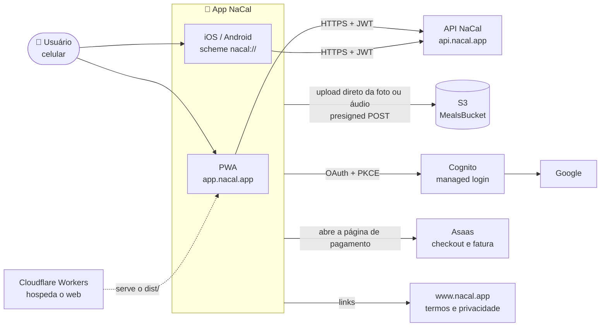
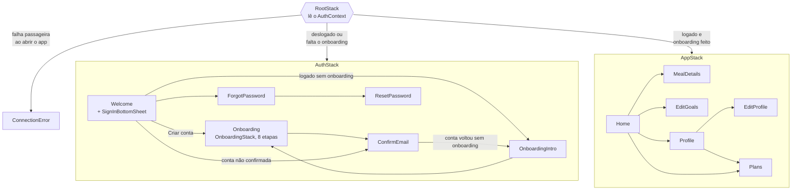

# 01 · Visão geral

O app do NaCal é um projeto **Expo** (SDK 57, React Native 0.86, React 19, TypeScript strict) que roda no **navegador como PWA**, no **iOS** e no **Android** a partir do mesmo código. O usuário registra refeições por foto, áudio ou texto, acompanha o dia contra a meta de calorias e macros e assina o plano Pro. Toda a regra de negócio pesada (IA, cotas, cálculo da meta, pagamento) fica na API; o app captura, mostra e reage.

O web é a **superfície principal de validação**: o app está publicado em `app.nacal.app` (Cloudflare Workers) e é usado principalmente instalado na tela inicial do celular. Os builds nativos existem e precisam continuar funcionando (paridade web/nativo é regra do projeto).

## Contexto: com quem o app conversa

| Sistema | Para quê | Onde no código |
|---|---|---|
| **API NaCal** | Tudo: auth, perfil, metas, refeições, cotas e billing | [`src/app/services/`](../../src/app/services/) |
| **S3** | Recebe a foto ou o áudio direto do app, com o formulário assinado que a API devolve em `POST /create-meal` | [`Service.uploadPresignedPOST`](../../src/app/services/Service.ts) |
| **Cognito (managed login)** | Tela de login do Google. O app abre `/oauth2/authorize` com PKCE e troca o `code` pelos tokens **na API**, não no Cognito | [`useSocialAuth.ts`](../../src/app/hooks/useSocialAuth.ts) |
| **Asaas** | Página de checkout ou fatura. O app só abre a URL que a API devolveu; a ativação chega pela API (webhook) e o app confere no `GET /me` | [`usePlansScreen.ts`](../../src/ui/screens/plans/usePlansScreen.ts) |
| **www.nacal.app** | Termos de Uso, Política de Privacidade e o e-mail de suporte | [`config/legal.ts`](../../src/app/config/legal.ts) |
| **Cloudflare Workers** | Hospeda o export estático do web (Worker `nacal-app`) | [`wrangler.jsonc`](../../wrangler.jsonc), [06 · Plataformas](06-plataformas-build-deploy.md#deploy-do-web-cloudflare-workers) |

O app **nunca** fala com OpenAI, DynamoDB ou o webhook do Asaas. Se uma regra depende deles, ela mora na API.

## Mapa de navegação

A navegação é [React Navigation 7](https://reactnavigation.org/) com `native-stack`, sem abas. O `RootStack` mostra uma de três coisas, conforme o estado do [`AuthContext`](03-navegacao-e-sessao.md):

## Inventário de telas

### AuthStack (deslogado ou sem onboarding)

| Tela | O que faz | Pasta |
|---|---|---|
| `Welcome` | Boas-vindas. Abre o `SignInBottomSheet` (e-mail/senha e Google) e leva ao cadastro | [`screens/welcome`](../../src/ui/screens/welcome/) |
| `OnboardingIntro` | Introdução para quem **já está logado sem onboarding** (entrou com Google numa conta nova, ou confirmou o e-mail e a conta voltou sem perfil), com "Começar" e "Sair da conta". O cadastro por e-mail não passa por ela: "Criar conta" vai direto ao `Onboarding` | [`screens/onboarding/intro`](../../src/ui/screens/onboarding/intro/) |
| `Onboarding` | Container das 8 etapas (`OnboardingStack`), com um único formulário react-hook-form | [`screens/onboarding`](../../src/ui/screens/onboarding/) |
| `ConfirmEmail` | Código de 6 dígitos do cadastro, com reenvio a cada 30 s | [`screens/confirmEmail`](../../src/ui/screens/confirmEmail/) |
| `ForgotPassword` | Pede o código de recuperação | [`screens/forgotPassword`](../../src/ui/screens/forgotPassword/) |
| `ResetPassword` | Código + nova senha | [`screens/forgotPassword/resetPassword`](../../src/ui/screens/forgotPassword/resetPassword/) |

### AppStack (logado)

| Tela | O que faz | Pasta |
|---|---|---|
| `Home` | Calendário da semana, MacroRainbow, refeições do dia, FAB de criação, avisos de plano | [`screens/home`](../../src/ui/screens/home/) |
| `MealDetails` | Totais e itens da refeição; adicionar, remover e restaurar itens; excluir a refeição | [`screens/mealDetails`](../../src/ui/screens/mealDetails/) |
| `EditGoals` | Edição manual da meta diária | [`screens/editGoals`](../../src/ui/screens/editGoals/) |
| `Profile` | Hub de ajustes: perfil, plano, instalar o app, termos, sair e excluir conta | [`screens/profile`](../../src/ui/screens/profile/) |
| `EditProfile` | Nome, nascimento, altura, peso e gênero | [`screens/editProfile`](../../src/ui/screens/editProfile/) |
| `Plans` | Free vs Pro, trial, checkout, confirmação do pagamento e cancelamento | [`screens/plans`](../../src/ui/screens/plans/) |

### Fora das stacks

| Tela / componente | Quando aparece |
|---|---|
| `ConnectionError` | Ao abrir o app, o `GET /me` falhou por rede, timeout, `429` ou `5xx` e ainda há tokens guardados ([03](03-navegacao-e-sessao.md#abertura-do-app)) |
| `DesktopGate` | No web, com a janela acima de 480 px de largura: mostra um aviso no lugar do app |
| Modais de criação | `PhotoModal`, `AudioModal` e `TextMealModal`, abertos pelo FAB da Home (são `Modal` do React Native, não telas da stack) |

## Rotas da API que o app usa

| Domínio | Rotas | Service |
|---|---|---|
| Auth | `POST /auth/sign-in`, `/auth/sign-up`, `/auth/confirm-sign-up`, `/auth/resend-confirmation-code`, `/auth/refresh-token`, `/auth/forgot-password`, `/auth/confirmation-forgot-password`, `/auth/oauth/callback`, `/auth/complete-onboarding` | `AuthService`, `AccountsService` |
| Conta | `GET /me`, `PUT /profiles`, `POST /goals` | `AccountsService`, `GoalService` |
| Refeição | `POST /create-meal`, `POST /meals/text`, `GET /meals?date=`, `GET /meals/{id}`, `POST /meals/{id}/items`, `DELETE /meals/{id}/items/{itemId}`, `POST /meals/{id}/items/{itemId}/restore`, `DELETE /meals/{id}` | `MealsService` |
| Billing | `GET /billing/plans`, `POST /billing/trial`, `POST /billing/checkout`, `POST /billing/cancel` | `BillingService` |

Nas páginas de fluxo, 🔒 marca as rotas que exigem o access token do Cognito (header `Authorization: Bearer`, posto pelo `Service`). As rotas `/auth/*` são públicas; o `complete-onboarding` recebe o access token no body.

O contrato de cada rota (body, resposta, erros, rate limit) está no [README da API](https://github.com/nivaldoandrade/nacal-api/blob/main/README.md).
