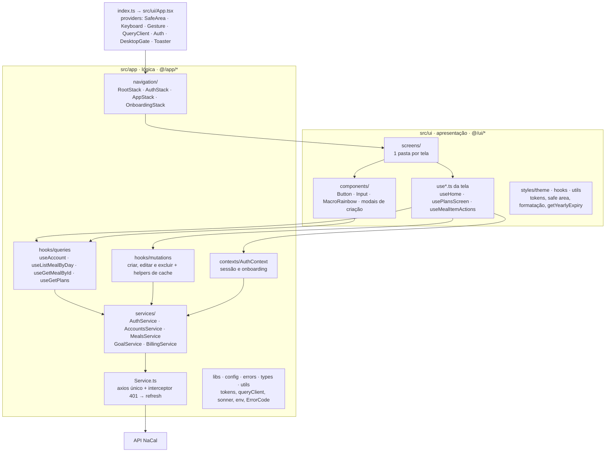
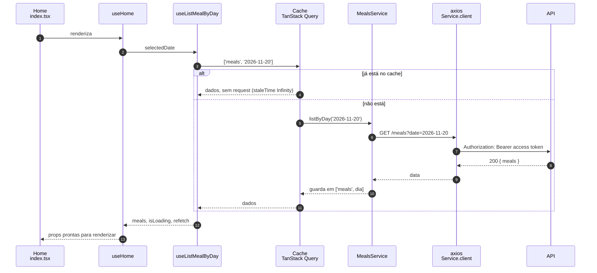

# 02 · Arquitetura do código

O código tem **duas camadas**, separadas por pasta e por alias de import: `src/ui` (o que aparece na tela) e `src/app` (lógica sem layout). A tela não chama a API direto: ela usa um hook próprio, que usa um hook do TanStack Query, que usa um Service, que usa o axios.

## Camadas



| Camada | Pasta | Responsabilidade |
|---|---|---|
| **ui** | `src/ui/` | Telas, componentes, estilos, hooks de tela e utilitários de exibição (formatar preço, data, idade) |
| **app** | `src/app/` | Services HTTP, hooks de query e mutation, `AuthContext`, navegação, config, erros, tipos e libs com diferença por plataforma (toast, PWA, arquivo) |

Os imports usam aliases definidos no `tsconfig.json`: `@/app/*` → `src/app/*` e `@/ui/*` → `src/ui/*`.

> **A separação não é estrita.** `src/app/navigation/` importa as telas de `src/ui/screens/` (é onde as rotas são registradas) e o `AuthService` usa o tipo do schema do onboarding (`OnboardingSchemaOutput`) como body do sign-up. Fora isso, `app` não importa nada de `ui`.

## Mapa das pastas

```text
src/
├── app/
│   ├── config/            env.ts (zod das EXPO_PUBLIC_*), mealImage.ts, legal.ts
│   ├── contexts/          AuthContext: isSignedIn, shouldShowOnboarding, sessão pendente de confirmação
│   ├── errors/            apiErrors.ts: ErrorCode, mensagens em pt-BR, getApiErrorCode
│   ├── hooks/
│   │   ├── queries/       useAccount, useListMealByDay, useGetMealById, useGetPlans
│   │   ├── mutations/     useCreateMeal, useCreateTextMeal, useAddMealItems, useRemoveMealItem,
│   │   │                  useRestoreMealItem, useDeleteMeal, useUpdateGoal, useUpdateProfile,
│   │   │                  useStartTrial, useCreateCheckout, useCancelSubscription,
│   │   │                  mealItemsCache.ts, mealQuotaCache.ts
│   │   ├── useSocialAuth.ts   Google OAuth + PKCE
│   │   └── usePwaInstall.ts   dica de instalação do PWA
│   ├── libs/              AuthTokenManager, queryClient, sonner(.web), pwaInstall(.web),
│   │                      getFileInfo, getDeviceTimeZone, getCheckoutReturnUrl,
│   │                      getMealRejectionMessage, openExternalUrl, *Storage
│   ├── navigation/        index.tsx (NavigationContainer + linking), RootStack, AuthStack,
│   │                      AppStack, OnboardingStack
│   ├── services/          Service (base) + 1 Service por domínio da API
│   ├── types/             Meal, Food, Subscription, Goal, Gender, ActivityLevel
│   └── utils/             toLocalIsoDate, ValueOf
└── ui/
    ├── App.tsx            raiz: fontes, splash e providers
    ├── components/        componentes compartilhados entre telas
    ├── hooks/             useSafeAreaInsets (mínimo de 16/24 px no web)
    ├── screens/           1 pasta por tela (ver convenção abaixo)
    ├── styles/            theme (cores, fontes) e cva (variantes de estilo)
    └── utils/             formatação, idade, meta, getYearlyExpiry
```

## Fluxo de dados

O caminho de uma leitura e de uma escrita, com a Home como exemplo:



Na escrita, a mutation chama o Service e, no `onSuccess`, **atualiza o cache** (`setQueryData`) ou **marca como desatualizado** (`invalidateQueries`). A escolha entre os dois é deliberada em cada mutation e está explicada em [04 · Cache](04-cache-e-dados-locais.md#escrever-no-cache-ou-invalidar).

Regras que valem para todo o app:

- **Service converte datas.** A API devolve ISO strings; o Service transforma em `Date` antes de entregar (`createdAt` da refeição, `trialEndsAt` e `paidUntil` da assinatura, `birthDate` do perfil). Datas sem hora (`birthDate`, `paidUntil`) são lidas pelo dia UTC e recriadas no fuso local, para não voltar um dia no Brasil (`parseDateFromAPI` em `AccountsService`).
- **Erros sobem como `AxiosError`.** Quem trata é o hook da tela, com `getApiErrorCode(error)` e `getErrorMessage(code)`. Ver [05 · Erros](05-erros-cotas-e-mensagens.md).
- **Toast sempre de `@/app/libs/sonner`**, nunca de `sonner` ou `sonner-native` direto.
- **`queryClient` com `retry: false`**: uma falha aparece na hora, sem o TanStack Query repetir sozinho.

## Convenção por pasta de tela ou componente

| Arquivo | Conteúdo |
|---|---|
| `index.tsx` | O componente. Idealmente só layout: recebe tudo pronto do hook |
| `styles.ts` | `StyleSheet.create` com os tokens de `@/ui/styles/theme` |
| `use<Nome>.ts` | Hook da tela: queries, mutations, navegação, toasts e estado local |
| `schema.ts` | Schema zod do formulário, usado com `react-hook-form` + `zodResolver` |
| `components/` | Subcomponentes usados só por essa tela |
| `I<Nome>.ts` | Tipo do `ref` imperativo de bottom sheets (`open`, `dismiss`) |

Regras de lint que diferem do padrão (`eslint.config.js`): interfaces com prefixo `I` (`IFoo`), aspas simples, ponto e vírgula, vírgula no fim em listas de várias linhas, `curly: all`, `eqeqeq` e `no-console: warn`.

## Arquivos por plataforma

O Metro escolhe o arquivo pela extensão: no web, `x.web.ts` ganha de `x.ts`. Hoje há três pares:

| Módulo | Nativo (`.ts` / `.tsx`) | Web (`.web.ts` / `.web.tsx`) |
|---|---|---|
| `libs/sonner` | reexporta `sonner-native` | reexporta `sonner` e embrulha o `Toaster` com offset da safe area |
| `libs/pwaInstall` | stub: sempre "instalado", nunca mostra a dica | lê o `beforeinstallprompt` capturado em `public/index.html` |
| `PhotoModal/.../CameraCapture` | `CameraView` do `expo-camera` | `<video>` com `getUserMedia`, zoom por pinça e captura em canvas |

> O `sonner.web.ts` precisa continuar `.web.ts`, sem JSX: com `.web.tsx`, o Metro acharia o `sonner.ts` antes e o web usaria o `sonner-native`.

Além disso, há cerca de 30 arquivos com `Platform.OS === 'web'` (arquivo da foto e do áudio, checkout, fechamento dos modais, cor de fundo do sistema). Antes de criar um caminho por plataforma, procure um que já exista. Lista completa em [06 · Plataformas](06-plataformas-build-deploy.md#onde-o-código-se-divide-por-plataforma).

## Como adicionar uma chamada nova à API

1. **Tipos e Service.** No Service do domínio (`src/app/services/`), crie o método estático usando `this.client` e declare `params`, `rawResponse` e `response` no `namespace` do Service. Converta datas para `Date` ali.
2. **Hook.** Leitura vira `useQuery` em `hooks/queries/` com uma query key nova (e `staleTime: Infinity`, como as outras). Escrita vira `useMutation` em `hooks/mutations/`, decidindo no `onSuccess` o que atualizar ou invalidar no cache.
3. **Erros.** Se a API devolve um código novo, adicione em `ErrorCode` e a mensagem amigável em `ApiErrorMessages` (`src/app/errors/apiErrors.ts`). O `Record<ErrorCode, string>` obriga a mensagem.
4. **Tela.** O hook da tela chama a mutation, trata os códigos que mudam o comportamento (fechar modal, navegar) e mostra o toast.
5. **Docs.** Atualize o fluxo correspondente aqui no guia e o README do app.

## Como adicionar uma tela nova

1. Crie a pasta em `src/ui/screens/<nome>/` com `index.tsx`, `styles.ts` e, se tiver dados, `use<Nome>.ts`.
2. Registre a rota no `ParamList` e no `Stack.Screen` do stack certo (`AppStack.tsx` para logado, `AuthStack.tsx` para deslogado). Os tipos `AppStackNavigatorProps` e `AppStackScreenRouteProps<'Nome'>` passam a enxergar a rota.
3. Se a tela precisar de uma URL própria no web (como `/billing/return`), adicione em `linking.config` (`src/app/navigation/index.tsx`).
4. Use `useSafeAreaInsets` de `@/ui/hooks/` (não o do `react-native-safe-area-context`): no web, ele garante o mínimo de 16 px em cima e 24 px embaixo.
5. Teste no web com a largura de um celular (o `DesktopGate` bloqueia acima de 480 px) e, se mexeu em algo nativo, num simulador.

## Formulários

Todos os formulários usam `react-hook-form` com `zodResolver`. O padrão:

- O schema fica no `schema.ts` da tela; mensagens de validação em pt-BR.
- Senhas passam por `trim` no schema antes da validação de tamanho (o Cognito recusa espaço nas pontas).
- Erro de campo vindo da API vai para `setError('<campo>', { type: 'api' })`; erro geral vai para `setError('root.api')` e aparece no rodapé do formulário.
- Os botões de salvar de `EditGoals` e `EditProfile` só habilitam com `isDirty && isValid`.
- O onboarding é **um formulário só** para as 8 etapas, com `FormProvider` no container; cada etapa valida o próprio campo com `trigger` (ver [cadastro](fluxos/auth-cadastro-email.md)).
