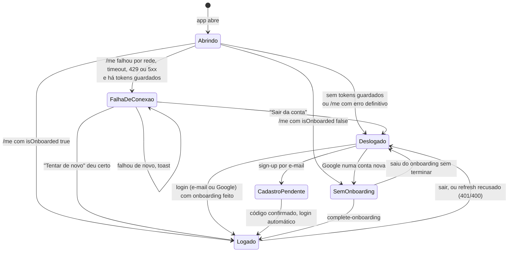
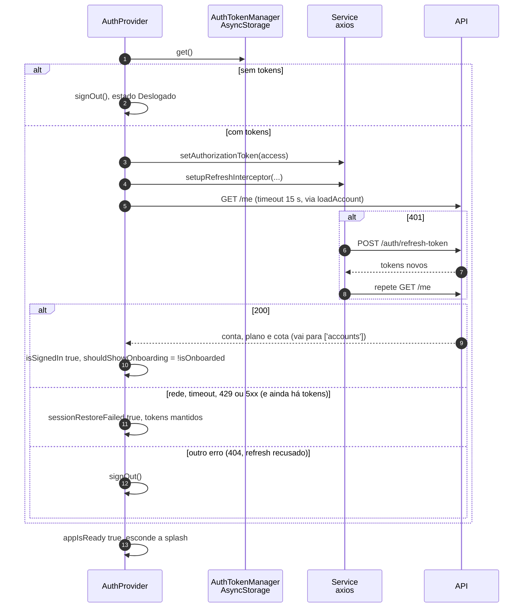
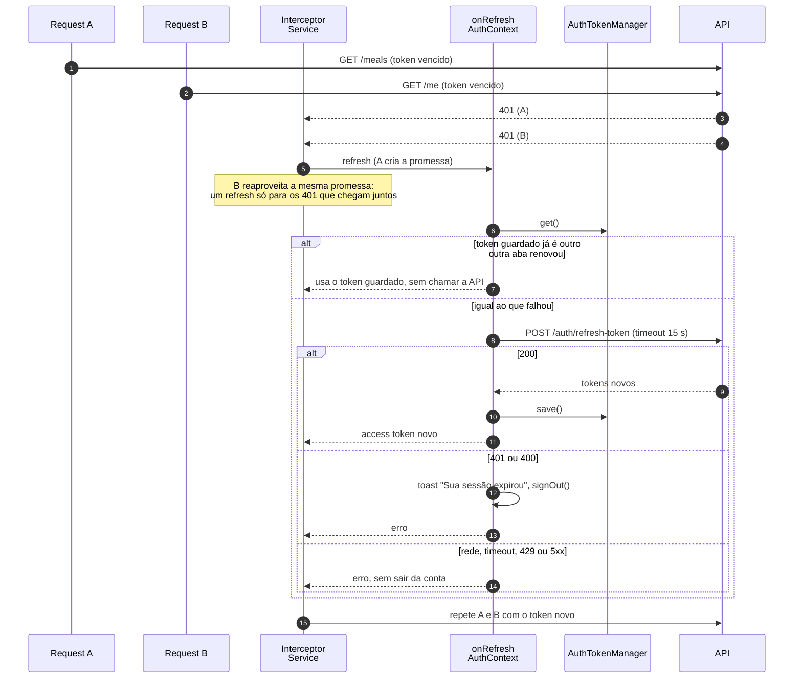

# 03 · Navegação e sessão

Quem decide o que aparece na tela é o **`AuthContext`** ([`src/app/contexts/AuthContext/index.tsx`](../../src/app/contexts/AuthContext/index.tsx)). O `RootStack` só lê três flags dele e escolhe entre `ConnectionError`, a `AuthStack` e a `AppStack`. Não existe `navigate('Home')` depois do login: o login muda o estado e o `RootStack` troca de stack sozinho.

## Árvore de providers

```text
App.tsx
└── SafeAreaProvider
    └── KeyboardProvider
        └── GestureHandlerRootView
            ├── QueryClientProvider (queryClient com retry: false)
            │   └── AuthProvider        ← devolve null até terminar a abertura
            │       └── DesktopGate     ← bloqueia web > 480 px
            │           └── Navigation  ← NavigationContainer + linking + BottomSheetModalProvider
            │               └── RootStack
            └── Toaster (global, bottom-center)
```

O `App.tsx` segura a splash nativa (`SplashScreen.preventAutoHideAsync`) e não renderiza nada até as fontes Host Grotesk carregarem. O `AuthProvider` também devolve `null` até terminar a abertura do app; só então esconde a splash e, no web, remove o `<div id="pwa-splash">` do `public/index.html`.

## Estados da sessão



| Estado | Flags no `AuthContext` | O que o `RootStack` mostra |
|---|---|---|
| Abrindo | `appIsReady: false` (interno) | Nada: o `AuthProvider` devolve `null` e a splash continua |
| Falha de conexão | `sessionRestoreFailed: true` | `ConnectionError` ("Tentar de novo" e "Sair da conta") |
| Deslogado | `isSignedIn: false` | `AuthStack` em `Welcome` |
| Cadastro pendente | `isSignedIn: false`, `hasPendingSignUp: true` | `AuthStack` (quem abre `ConfirmEmail` é o `navigate` do `CreateAccountStep`, não o `RootStack`) |
| Sem onboarding | `isSignedIn: true`, `shouldShowOnboarding: true` | `AuthStack`; a `Welcome` empurra para `OnboardingIntro` |
| Logado | `isSignedIn: true`, `shouldShowOnboarding: false` | `AppStack` em `Home` |

Outras flags do contexto:

- **`isSignedUp`**: `true` só logo depois de criar a conta (onboarding concluído ou e-mail confirmado). A Home usa para mostrar os modais de boas-vindas ao plano e para não exibir a splash de carregamento ([Home](fluxos/home-e-dia.md#modais-do-primeiro-acesso)). Não é persistido.
- **`pendingSignUp`** (interno) e **`pendingSignUpEmail`**: e-mail e senha do cadastro **só em memória**, para a confirmação provar que quem confirma é quem criou a conta. Some ao recarregar o app ([cadastro](fluxos/auth-cadastro-email.md)).

## Abertura do app



- O `GET /me` da abertura é a mesma query `['accounts']` que o resto do app usa (`useAccount({ enabled: false })` + `refetch({ throwOnError: true })`). A Home já abre com a conta, o plano e a cota no cache.
- O timeout de 15 s do `/me` e do refresh existe para a splash nunca ficar presa: sem ele, uma rede travada deixaria o app em branco.
- `ConnectionError` mantém os tokens: o usuário não precisa logar de novo só porque abriu o app sem sinal. "Tentar de novo" roda a mesma restauração; se falhar de novo, mostra o toast "Ainda não conseguimos conectar. Tente de novo em instantes."

## Refresh do token

O access token do Cognito dura 1 h. Quando ele vence, a API responde `401` e o interceptor de resposta do axios ([`Service.ts`](../../src/app/services/Service.ts)) renova sem o usuário perceber:



Regras do interceptor:

| Regra | Por quê |
|---|---|
| Só age em `401`, e nunca no próprio `/auth/refresh-token` | Evita loop de refresh |
| Uma promessa de refresh por vez (`Service.refreshing`) | Vários `401` simultâneos geram um refresh só; refresh token usado duas vezes ao mesmo tempo poderia ser recusado |
| Cada request repete no máximo 2 vezes (`MAX_AUTH_RETRIES`) | Um `401` persistente (token recusado pela API por outro motivo) não vira loop infinito |
| Compara o token que falhou com o guardado | No web, outra aba pode ter renovado antes (o `AsyncStorage` do web é o `localStorage`, compartilhado entre abas). Reaproveita em vez de gastar outro refresh |
| Só desloga com `401`/`400` no refresh, ou sem tokens guardados | Sem rede, timeout, `429` e `5xx` só fazem a request falhar; o usuário continua logado |
| Descarta `401` de uma sessão anterior | Ver "geração da sessão" abaixo |

### Geração da sessão

`sessionGenerationRef` é um contador que aumenta a cada `signOut`. O callback de refresh guarda a geração em que foi criado e recusa rodar se ela mudou. Isso cobre o caso de uma request lenta da sessão antiga voltar com `401` **depois** de o usuário sair e entrar com outra conta: sem a checagem, o refresh usaria os tokens da sessão nova para repetir a request da antiga. O mesmo vale para um refresh que termina depois do `signOut`: os tokens novos não são salvos.

## Sair da conta

`signOut()` faz, nessa ordem:

1. Incrementa a geração da sessão.
2. Remove o header `Authorization` e o interceptor do axios.
3. Apaga os tokens do `AsyncStorage` (`@nacal:authtokens`).
4. `queryClient.clear()`: limpa **todo** o cache, para a próxima conta não ver dados da anterior.
5. Zera as flags (`isSignedIn`, `isSignedUp`, `shouldShowOnboarding`, `pendingSignUp`, `sessionRestoreFailed`).

Não há chamada à API (`/auth/sign-out` não existe); o refresh token continua válido no Cognito até expirar.

Onde o `signOut` é chamado: botão "Sair" do Perfil, "Sair da conta" do `ConnectionError` e do `OnboardingIntro`, refresh recusado e, automaticamente, ao **sair do onboarding sem terminar** com Google. Nesse último caso, se o usuário está logado, sem onboarding e sem cadastro pendente, o `OnboardingIntro` chama `signOut` no `beforeRemove` (a tela vai sair da pilha) e o container `Onboarding` chama na limpeza do `useFocusEffect` (a tela perdeu o foco). Assim, quem desiste do onboarding volta para a `Welcome` deslogado, em vez de ficar preso numa conta sem perfil.

## Deep link e URLs no web

`src/app/navigation/index.tsx` configura o `linking`:

| | Web | Nativo |
|---|---|---|
| Prefixo | `window.location.origin` | `nacal://` (scheme do `app.json`) |
| `/` | `Home` | `Home` |
| `/billing/return` | `Plans`, com `Home` embaixo na pilha | `Plans` |

Só essas duas rotas têm URL. `/billing/return` é o retorno do checkout do Asaas: ao abrir o app direto nessa URL, o `initialRouteName: 'Home'` monta `[Home, Plans]`, para o botão de voltar do cabeçalho ter para onde ir ([billing](fluxos/billing.md#checkout-no-web)). As outras telas não mudam a URL.

O callback do Google não passa pelo `linking`: o `expo-auth-session` resolve o retorno (no web, `WebBrowser.maybeCompleteAuthSession()` no topo do `useSocialAuth`).

## Arquivos envolvidos

| Parte | Arquivo |
|---|---|
| Providers e splash | [`src/ui/App.tsx`](../../src/ui/App.tsx) |
| Estado da sessão | [`AuthContext/index.tsx`](../../src/app/contexts/AuthContext/index.tsx), [`useAuth.ts`](../../src/app/contexts/AuthContext/useAuth.ts) |
| Tokens | [`AuthTokenManager.ts`](../../src/app/libs/AuthTokenManager.ts) |
| Interceptor e client | [`Service.ts`](../../src/app/services/Service.ts) |
| Stacks e linking | [`src/app/navigation/`](../../src/app/navigation/) |
| Falha de conexão | [`screens/connectionError`](../../src/ui/screens/connectionError/) |
| Lado da API | [Login, refresh e senha](https://github.com/nivaldoandrade/nacal-api/blob/main/docs/guide/fluxos/auth-login-senha.md) |
