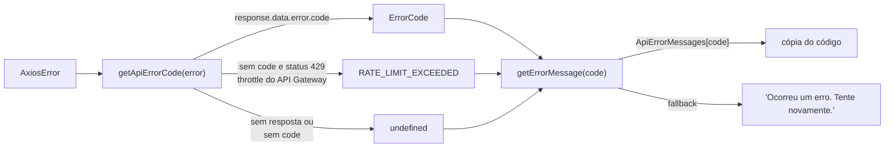

# 05 · Erros, cotas e mensagens

A API responde erro sempre no mesmo formato, `{ "error": { "code": "...", "message": "..." } }`. O app **ignora a `message`** da API e mostra a própria cópia, em pt-BR e no tom do produto, escolhida pelo `code`.

## Como um erro vira mensagem

Tudo em [`src/app/errors/apiErrors.ts`](../../src/app/errors/apiErrors.ts):

- `ErrorCode`: os códigos que o app conhece. É um subconjunto dos códigos da API ([catálogo da API](https://github.com/nivaldoandrade/nacal-api/blob/main/docs/guide/05-erros-cotas-rate-limit.md)).
- `ApiErrorMessages`: `Record<ErrorCode, string>`; o TypeScript obriga uma mensagem para cada código novo.
- `getApiErrorCode`: lê o `code` do corpo. O `429` do throttle do API Gateway vem sem corpo no nosso formato (`{"message":"Too Many Requests"}`), então vira `RATE_LIMIT_EXCEEDED` pelo status.
- `getErrorMessage`: devolve a cópia ou a mensagem genérica.

Algumas telas usam um texto próprio em vez do `getErrorMessage` quando o contexto pede (por exemplo, "Não conseguimos remover o item. Tente novamente!").

## Onde o toast aparece

Há **dois** `<Toaster>`:

| Toaster | Onde está | Quando usar |
|---|---|---|
| Global | `App.tsx`, `bottom-center` | Padrão. Erros e confirmações em telas |
| Do modal (`id: 'modal'`) | Dentro do `ModalWrapper` | Toast que precisa aparecer **com um modal aberto** (o `Modal` do React Native fica por cima do toaster global). Use `toast.x(msg, { toasterId: MODAL_TOASTER_ID })` |

A regra prática: se o erro mantém o modal aberto (o usuário vai corrigir e tentar de novo), use o toaster do modal; se o erro fecha o modal, use o global depois de fechar.

Ids fixos evitam toasts repetidos: `session-expired` (refresh recusado) e `connection-retry` (falha ao tentar de novo na abertura).

## Reação por código

| Código | Origem | Reação no app |
|---|---|---|
| `VALIDATION` | Qualquer rota com body | Erro no rodapé do formulário (`root.api`); em `EditGoals` e `EditProfile`, também toast |
| `EMAIL_ALREADY_IN_USE` | Sign-up | Erro no campo de e-mail do `CreateAccountStep` |
| `EMAIL_LINKED_TO_GOOGLE` | Sign-up e sign-in | Sign-up: erro no campo de e-mail. Sign-in: erro no rodapé do login |
| `EMAIL_NOT_CONFIRMED` | Sign-in | Fecha o login e leva para `ConfirmEmail`, que reenvia o código ([login](fluxos/auth-login-e-senha.md)) |
| `INVALID_CONFIRMATION_CODE` | Confirmação do cadastro | Erro no campo do código (o `BAD_REQUEST` da confirmação e da redefinição de senha recebe a mesma cópia) |
| `INVALID_CREDENTIALS` | Sign-in | Erro no rodapé do login. Na confirmação do cadastro, significa que a senha guardada não serve mais: a tela pede para entrar de novo |
| `BETA_ACCESS_DENIED` | Sign-up e Google | Mensagem de beta fechado. No Google, vem dentro do `error_description` do redirect do Cognito |
| `TOO_MANY_ATTEMPTS`, `CODE_DELIVERY_FAILED` | Rotas de código e senha | Erro no formulário ou toast |
| `INVALID_REFRESH_TOKEN` | Refresh | Não chega a uma tela: o `AuthContext` usa a cópia no toast "Sua sessão expirou" ([sessão](03-navegacao-e-sessao.md#refresh-do-token)) |
| `INVALID_GRANT` | Google (callback) e `complete-onboarding` | Apaga os tokens; no onboarding com Google, tenta o login com Google **uma vez** de novo ([Google](fluxos/auth-google.md)) |
| `RESOURCE_NOT_FOUND` | Refeição | Excluir: conta como sucesso. Adicionar item: fecha o modal |
| `NO_FOOD_IDENTIFIED` | Texto e adicionar item | Toast no modal, mantém o texto para editar |
| `MEAL_NOT_EDITABLE`, `MEAL_ITEM_LIMIT_REACHED`, `MEAL_LAST_ITEM` | Itens | Toast; adicionar item fecha o modal ([itens](fluxos/refeicao-itens.md#erros-e-casos-de-borda)) |
| `FREE_QUOTA_EXCEEDED` | Criar refeição, adicionar item | Criar: fecha o modal, toast e **navega para `Plans`**. Adicionar item: fecha o modal com toast |
| `DAILY_MEAL_LIMIT_REACHED` | Criar refeição (Pro) | Fecha o modal com toast, sem ir para `Plans` (o usuário já é Pro), e atualiza a cota |
| `TRIAL_NOT_AVAILABLE`, `BILLING_ERROR` | Billing | Toast na tela de Planos |
| `SUBSCRIPTION_ALREADY_ACTIVE` | Checkout | Toast e recarga de `['accounts']`, para a tela mostrar a situação real |
| `RATE_LIMIT_EXCEEDED` | Qualquer rota com rate limit, ou throttle do API Gateway | Toast "Aguarde alguns instantes", sem fechar modal nem perder o que foi digitado. Exceção: o login, `EditGoals` e `EditProfile` leem o `code` direto do corpo, sem `getApiErrorCode`; o `429` do throttle do API Gateway (sem `code`) cai na mensagem genérica, e no login aparece no rodapé |
| Sem resposta (rede, timeout) | — | Mensagem genérica. Na abertura do app, leva ao `ConnectionError` |

## Rejeição não é erro

Uma foto sem comida ou um áudio sem fala **não** voltam como erro HTTP: o `POST /create-meal` dá certo e a refeição termina com status `REJECTED` e um `rejectionReason`. O modal trata isso como um resultado esperado, com toast informativo (`toast.info`, não `toast.error`):

| `rejectionReason` | Entrada | Mensagem |
|---|---|---|
| `INVALID_FILE` | qualquer | "Não conseguimos processar esse arquivo. Tente novamente." |
| `NOT_A_MEAL` ou `NO_FOOD_DETECTED` | áudio | "Não conseguimos identificar alimentos nesse áudio. Tente novamente!" |
| `NOT_A_MEAL` ou `NO_FOOD_DETECTED` | foto | "Não conseguimos identificar uma refeição nessa foto. Tente outra foto!" |

[`getMealRejectionMessage.ts`](../../src/app/libs/getMealRejectionMessage.ts). A API estorna a cota de **até 5 rejeições por dia** (dia de São Paulo); a partir da 6ª, a refeição rejeitada fica com a cota, sem mensagem diferente no app. Uma falha (`FAILED`) é sempre estornada. Nos dois casos o app invalida `['accounts']` para mostrar a cota real.

## Cotas na interface

A API é a dona da regra; o app só mostra o que vem no `GET /me` (e no `201` das criações):

| Campo | Free | Pro (mensal, anual ou trial) |
|---|---|---|
| `mealQuota` | `{ used, limit: 20, remaining }` do mês | `{ used, limit: null, remaining: null }` |
| `dailyMealQuota` | `null` | `{ used, limit: 20, remaining }` do dia (fuso `America/Sao_Paulo`) |

O que a interface faz com isso:

| Componente | Free | Pro |
|---|---|---|
| `MealQuotaNotice` (no FAB e nos modais de foto, áudio e texto) | Sempre: "Restam N de 20 refeições este mês" (link para Planos); esgotado, "Limite do Free atingido este mês. Ver planos Pro" | Só com 5 ou menos no dia: "Restam N refeições hoje"; esgotado, "Você chegou ao limite de hoje. Amanhã tem mais!" |
| Opções do FAB (Áudio, Foto, Texto) | Desativadas com a cota do mês esgotada | Desativadas com a cota do dia esgotada |
| Ao abrir o FAB | `loadAccount()` busca o `/me` de novo, para a cota não estar velha | Idem |

A checagem no app é só visual. Se a cota acabar entre abrir o FAB e enviar, a API recusa com `403 FREE_QUOTA_EXCEEDED` ou `429 DAILY_MEAL_LIMIT_REACHED` e a tabela de reações acima vale.

Regras que vêm da API e explicam números "estranhos" na tela:

- O Free conta **só as refeições feitas no Free**: quem volta do trial ou do Pro no meio do mês tem 20 menos o que já tinha usado no Free naquele mês.
- Adicionar item não consome cota, mas é bloqueado para Free sem cota restante.
- Refeição por texto sem nenhum alimento não consome cota; foto e áudio consomem antes do upload; a falha é sempre estornada e a rejeição só até 5 por dia.

## Arquivos envolvidos

| Parte | Arquivo |
|---|---|
| Códigos e mensagens | [`errors/apiErrors.ts`](../../src/app/errors/apiErrors.ts) |
| Toast por plataforma | [`libs/sonner.ts`](../../src/app/libs/sonner.ts), [`libs/sonner.web.ts`](../../src/app/libs/sonner.web.ts) |
| Toaster do modal | [`components/ModalWrapper`](../../src/ui/components/ModalWrapper/index.tsx) |
| Aviso de cota | [`components/MealQuotaNotice`](../../src/ui/components/MealQuotaNotice/index.tsx) |
| FAB | [`home/components/Fab`](../../src/ui/screens/home/components/Fab/index.tsx) |
| Cotas na API | [Erros, cotas e rate limit](https://github.com/nivaldoandrade/nacal-api/blob/main/docs/guide/05-erros-cotas-rate-limit.md) |
