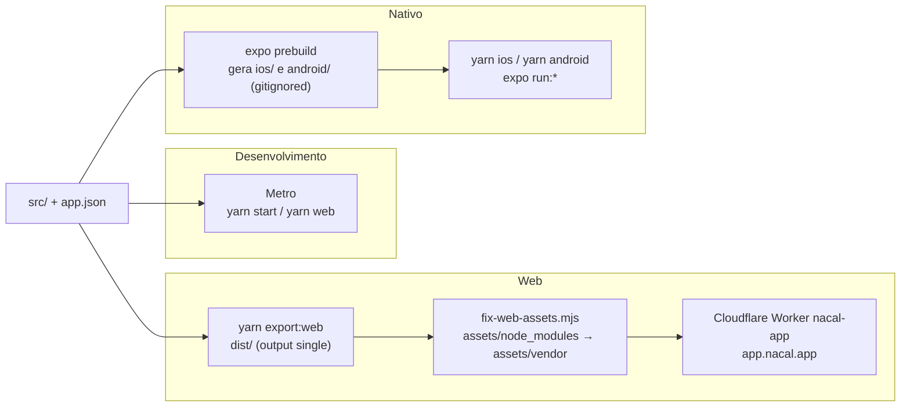
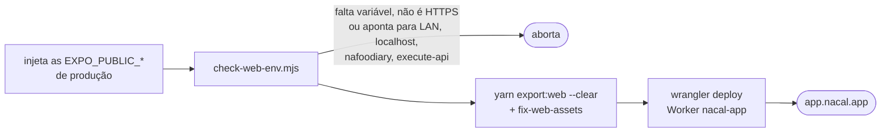

# 06 · Plataformas, build e deploy

O mesmo código gera três alvos: **web** (export estático servido pelo Cloudflare Workers e instalável como PWA), **iOS** e **Android**. O web é o alvo que está em produção e onde as mudanças são validadas primeiro; os builds nativos precisam continuar compilando e funcionando.

## Alvos



| Alvo | Como roda | Observações |
|---|---|---|
| Web (dev) | `yarn web` → `http://localhost:8081` | Abra com a largura de um celular: acima de 480 px o `DesktopGate` bloqueia |
| Web (local de produção) | `yarn export:web` + `yarn serve:web`, ou `yarn preview` (Worker local com `wrangler dev`) | Usa o `.env`; para conferir o build real use `yarn deploy` (que injeta as variáveis de produção) |
| PWA no celular (dev) | `yarn web` + um proxy HTTPS na porta 8443 → `https://<ip-da-lan>:8443` ([passo a passo](#testar-no-celular-em-dev)) | Câmera e microfone no navegador do celular exigem HTTPS. Login com Google não completa no PWA de dev instalado no iOS; valide o Google no navegador em dev ou no PWA de produção |
| iOS / Android | `yarn ios` / `yarn android` | A primeira execução roda o prebuild. `npx expo prebuild --clean` regenera as pastas |

### Testar no celular em dev

O navegador do celular só libera câmera e microfone em HTTPS, e o Metro serve HTTP. A saída é um proxy HTTPS local na frente do Metro, com um certificado do [mkcert](https://github.com/FiloSottile/mkcert) em que o celular confia.

1. **Certificado** (uma vez por máquina, e de novo se o IP mudar). Na raiz do app, gere um certificado para `localhost` e para o IP da máquina na rede local:

   ```bash
   mkcert -install
   mkcert localhost <ip-da-lan>   # gera localhost+1.pem e localhost+1-key.pem
   ```

   Os `*.pem` ficam fora do git (`.gitignore`).
2. **Confiança no celular** (uma vez por aparelho). Envie o certificado raiz do mkcert (`rootCA.pem`, na pasta que `mkcert -CAROOT` mostra) para o iPhone, instale o perfil em Ajustes e ligue a confiança total em Ajustes → Geral → Sobre → Ajustes de Confiança de Certificados.
3. **Metro**: `yarn web` (porta 8081).
4. **Proxy HTTPS**, em outro terminal, na raiz do app:

   ```bash
   yarn dlx local-ssl-proxy --source 8443 --target 8081 --cert localhost+1.pem --key localhost+1-key.pem
   ```

5. No celular, na mesma rede Wi-Fi, abra `https://<ip-da-lan>:8443`. Para testar o PWA instalado, adicione à tela inicial a partir daí.
6. Para o checkout voltar para esse endereço, `EXPO_PUBLIC_WEB_URL` (aqui) e `APP_WEB_URL` (na API) precisam ser `https://<ip-da-lan>:8443` ([variáveis](#variáveis-de-ambiente)).

## Web e PWA

- **Bundler**: Metro com `web.output: "single"` (SPA). O `public/index.html` é o template e traz scripts e marcação inline que rodam antes do React:
  - `pwa-install-prompt`: guarda o evento `beforeinstallprompt` em `window.__nacalInstallPrompt` (o evento chega antes do bundle carregar e só pode ser usado uma vez);
  - `pwa-zoom-lock`: no modo instalado (`display-mode: standalone`), marca o `<html>` com `pwa-standalone` e bloqueia o zoom por pinça;
  - `theme-color-sync`: copia a cor de fundo do `body` (que o `expo-system-ui` muda por tela) para a `meta theme-color`, escurecendo cores muito claras no modo instalado;
  - `pwa-splash`: não é script, é um `<div>` com o próprio `<style>`; splash em HTML que o `AuthProvider` remove quando a abertura termina.
- **Manifest e ícones**: `public/manifest.json`, ícones 192/512/maskable, `apple-touch-icon` e a splash. Regenerar com `python3 scripts/generate-icons.py` ([`scripts/README.md`](../../scripts/README.md)).
- **`DesktopGate`**: no web, `window.innerWidth > 480` mostra um aviso no lugar do app (o produto é só para celular). Para testar no desktop, use as DevTools responsivas ou um iframe de 430 px.
- **Dica de instalação**: `usePwaInstall` combina o evento guardado (`pwaInstall.web.ts`) com a plataforma detectada pelo user agent (Safari do iOS, outro navegador no iOS, navegador dentro de app como Instagram, Android). O `InstallAppSheet` abre sozinho na Home depois dos modais de plano, e o Perfil tem a entrada manual ([Home](fluxos/home-e-dia.md#modais-do-primeiro-acesso)). No nativo, o stub diz que o app já está instalado e a dica nunca aparece.

## Onde o código se divide por plataforma

Três módulos têm arquivo próprio para o web ([02](02-arquitetura-codigo.md#arquivos-por-plataforma)): `sonner`, `pwaInstall` e `CameraCapture`. Os outros pontos usam `Platform.OS`:

| Assunto | Web | Nativo | Onde |
|---|---|---|---|
| Arquivo da foto | `File` do navegador; reencoda para JPEG por canvas se não for JPEG, passar de 2 MB ou de 1024 px | `expo-image-manipulator` para JPEG de até 1024 px; lê com `expo-file-system` | `libs/getFileInfo.ts` |
| Arquivo do áudio | `blob:` ou `data:` → `File` `audio/webm` (ou `audio/m4a`) | arquivo `.m4a` do `expo-audio` | `libs/getFileInfo.ts` |
| Upload | `File` no `FormData` | `{ uri, name, type }` no `FormData` | `MealsService.create` |
| Fechar o modal depois de navegar para os detalhes | Fecha na hora | Espera o `transitionEnd` da navegação | `usePhotoModal`, `useAudioModal`, `useTextMealModal` |
| Checkout | Mesma aba (`location.assign`) + flag no `sessionStorage` | `WebBrowser.openAuthSessionAsync` | `usePlansScreen` |
| `returnUrl` do checkout | `EXPO_PUBLIC_WEB_URL` ou `window.location.origin` + `/billing/return` | `EXPO_PUBLIC_WEB_URL` ou `makeRedirectUri({ path: 'billing/return' })` | `libs/getCheckoutReturnUrl.ts` |
| Data de nascimento | `input type=date` do navegador | `@react-native-community/datetimepicker` (no iOS, dentro do `BirthDateBottomSheet`) | `BirthDateStep`, `BirthDateField`, `useBirthDate` |
| Deep link | `window.location.origin` | `nacal://` | `navigation/index.tsx` |
| Safe area | Mínimo de 16 px em cima e 24 px embaixo | Valores do sistema | `ui/hooks/useSafeAreaInsets.ts` |
| Cor de fundo do sistema (`expo-system-ui`) | `Home` (lime, ou escuro com modal de criação aberto), `SplashScreenLoader`, `MealDetails`, `EditGoals`, `Plans`, `Profile` e `Welcome` | Só a `Welcome` (e o "Sair" do Perfil, que volta a cor ao padrão) | As próprias telas |

## Variáveis de ambiente

| Variável | Para quê | Obrigatória |
|---|---|---|
| `EXPO_PUBLIC_API_URL` | `baseURL` do axios | Sim |
| `EXPO_PUBLIC_COGNITO_DOMAIN` | Domínio do managed login (`/oauth2/authorize`) | Sim |
| `EXPO_PUBLIC_COGNITO_CLIENT_ID` | Client do app no User Pool | Sim |
| `EXPO_PUBLIC_WEB_URL` | Base do `returnUrl` do checkout. Tem que passar pela allowlist `APP_WEB_URL` da API; o Asaas recusa `localhost` e `nacal://` | Não (obrigatória no deploy) |

- Só são lidas por **listas explícitas**: `src/app/config/env.ts` (validadas com zod na carga do módulo; faltar uma derruba o app na abertura) e `useSocialAuth.ts`. O Metro só embute no bundle as `process.env.EXPO_PUBLIC_X` escritas literalmente; ler `process.env` inteiro funciona no dev e quebra no export de produção.
- Depois de mudar o `.env`, reinicie o Metro (`yarn start -c` limpa o cache).
- Em dev, `EXPO_PUBLIC_WEB_URL` aponta para o IP da sua máquina na rede local, que muda de máquina para máquina e de rede para rede. O mesmo valor precisa estar em `APP_WEB_URL` no `.env` da API, que também define o CORS do bucket de refeições; depois de mudar, faça o deploy da API e reinicie o Metro. O Asaas aceita IP privado, mas recusa `localhost`.

## Deploy do web (Cloudflare Workers)

`yarn deploy` roda [`scripts/deploy-prod.mjs`](../../scripts/deploy-prod.mjs):



- As variáveis de produção são públicas (vão no bundle) e ficam no próprio script.
- `wrangler.jsonc`: assets em `dist/`, fallback de SPA (`not_found_handling: "single-page-application"`) e o domínio `app.nacal.app` como custom domain.
- `public/_headers` (copiado para `dist/`): `X-Frame-Options: DENY`, `nosniff`, `Referrer-Policy`, `Permissions-Policy` (câmera e microfone só na própria origem), cache imutável de 1 ano para `/_expo/static/*` e `/assets/*` e revalidação do `index.html`.
- `fix-web-assets.mjs` (o `postexport:web`) move `dist/assets/node_modules` para `dist/assets/vendor` e troca `/assets/node_modules/` por `/assets/vendor/` nos `.js`, `.css`, `.html`, `.json` e `.map`.
- Conferir depois do deploy: `curl -I https://app.nacal.app`.

O app em produção conversa com a API de produção (`api.nacal.app`).

## Nativo

- `app.json`: nome NaCal, scheme `nacal`, `bundleIdentifier`/`package` `com.nacal.app`, orientação retrato, tema claro.
- `ios/` e `android/` são gerados e ficam fora do git.
- **patch-package**: o `postinstall` aplica `patches/` a cada `yarn`. Hoje há um patch em `expo-modules-jsi` que corrige o build iOS no Xcode 26.3 / Swift 6.2 (bug upstream expo/expo#49214). Não remova o `postinstall` nem edite `node_modules` à mão.
- Não há publicação em loja nem EAS configurado.

## Verificações

Não há suíte de testes nem script de typecheck:

```bash
yarn lint           # expo lint, com as regras do eslint.config.js
npx tsc --noEmit    # typecheck
```

A validação de comportamento é manual: web na largura de um celular primeiro e, quando a mudança mexe em algo com `Platform.OS` ou arquivo `.web.*`, também num simulador ou aparelho.

## Arquivos envolvidos

| Parte | Arquivo |
|---|---|
| Config do Expo | [`app.json`](../../app.json) |
| Template web e scripts inline | [`public/index.html`](../../public/index.html) |
| Headers | [`public/_headers`](../../public/_headers) |
| Worker | [`wrangler.jsonc`](../../wrangler.jsonc) |
| Deploy | [`scripts/deploy-prod.mjs`](../../scripts/deploy-prod.mjs), [`check-web-env.mjs`](../../scripts/check-web-env.mjs), [`fix-web-assets.mjs`](../../scripts/fix-web-assets.mjs) |
| Variáveis | [`src/app/config/env.ts`](../../src/app/config/env.ts), [`.env.example`](../../.env.example) |
| Bloqueio de desktop | [`components/DesktopGate`](../../src/ui/components/DesktopGate/) |
| Instalação do PWA | [`usePwaInstall.ts`](../../src/app/hooks/usePwaInstall.ts), [`pwaInstall.web.ts`](../../src/app/libs/pwaInstall.web.ts), [`InstallAppSheet`](../../src/ui/components/InstallAppSheet/) |
