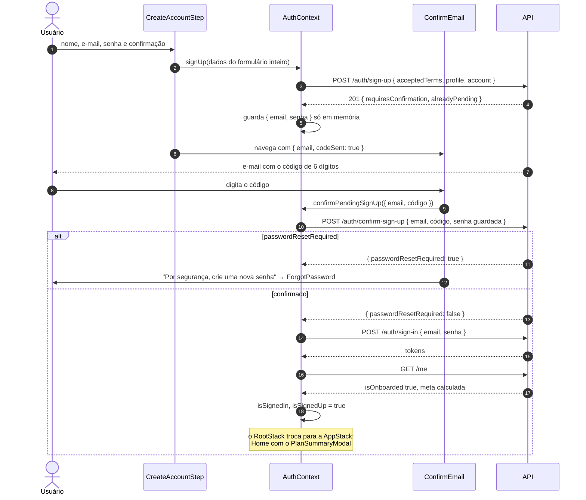

# Fluxo: onboarding e cadastro por e-mail

## Resumo

Quem toca em "Criar conta" na `Welcome` passa pelas **8 etapas do onboarding** num formulário só e, na última, cria a conta com e-mail e senha. A API cria um cadastro **pendente** e manda um código por e-mail. O app guarda a senha em memória, confirma o código junto com a senha e, se der certo, faz login automático e cai na Home com o plano calculado.

| | |
|---|---|
| **Telas** | `Welcome` → `Onboarding` (`TermsStep` ... `CreateAccountStep`) → `ConfirmEmail` |
| **Estado** | `useForm` + `FormProvider` no container `Onboarding`; `OnboardingProvider` controla as etapas; `AuthContext` guarda a senha pendente |
| **Rotas** | `POST /auth/sign-up`, `POST /auth/confirm-sign-up`, `POST /auth/resend-confirmation-code`, `POST /auth/sign-in`, `GET /me` |

## As 8 etapas

| # | Etapa | Campo do formulário | Validação |
|---|---|---|---|
| 1 | `TermsStep` | `acceptedTerms` | Precisa ser `true` (links para Termos e Privacidade em `www.nacal.app`) |
| 2 | `GoalStep` | `profile.goal` | Perder, manter ou ganhar peso |
| 3 | `GenderStep` | `profile.gender` | Obrigatório |
| 4 | `BirthDateStep` | `profile.birthDate` | Data no passado |
| 5 | `HeightStep` | `profile.height` | Obrigatório |
| 6 | `WeightStep` | `profile.weight` | Obrigatório |
| 7 | `ActivityLevelStep` | `profile.activityLevel` | Obrigatório |
| 8 | `CreateAccountStep` | `profile.name` + `account` | Nome de até 20 caracteres, e-mail válido, senha de 8+ caracteres (aparada) e confirmação igual |

A ordem e o campo de cada etapa estão em [`orderedSteps.ts`](../../../src/ui/screens/onboarding/orderedSteps.ts). Com o Google, a etapa 8 sai da lista (o usuário já tem conta) e o fim do onboarding chama `complete-onboarding` ([Google](auth-google.md)).

Como as etapas funcionam ([`onboarding/context/index.tsx`](../../../src/ui/screens/onboarding/context/index.tsx)):

- Cada etapa é uma rota do `OnboardingStack` (aninhado na `AuthStack`). "Continuar" chama `advance(campo)`, que valida **só aquele campo** com `trigger` e navega para a próxima.
- Ao entrar numa etapa depois da primeira, o provider valida todas as anteriores e, se alguma estiver inválida, volta para ela. Isso cobre o botão "voltar" do navegador e qualquer navegação que pule etapas.
- Voltar da primeira etapa faz `popToTop` (volta para a `Welcome`).
- O formulário vive só em memória: recarregar no meio volta para o começo.

## Diagrama de sequência

## Passo a passo

1. **Sign-up.** O body é a saída do schema do onboarding inteiro: `acceptedTerms`, `profile` (nome, objetivo, gênero, altura e peso como número, nível de atividade, nascimento em `AAAA-MM-DD`) e `account` (e-mail e senha). A API valida o beta, guarda o perfil num cadastro pendente e manda o código pelo Cognito.
2. **Senha em memória.** O `AuthContext` guarda `{ email normalizado, senha }` em `pendingSignUp`. Ela não vai para o storage: some ao recarregar o app.
3. **Confirmação.** `ConfirmEmail` recebe o código de 6 dígitos. Se a senha não está em memória para esse e-mail (app reaberto, ou chegou pelo login), a tela mostra um campo de senha acima do código. A decisão é tomada uma vez ao abrir a tela, para o campo não aparecer no meio do envio.
4. **Por que a senha vai junto.** A API usa a senha para provar que quem confirma é quem criou o cadastro. Se a senha não bater, a API troca a senha e responde `passwordResetRequired: true`; o app mostra "Por segurança, crie uma nova senha" e leva para o esqueci a senha.
5. **Login automático.** Com a confirmação aceita, o app faz `sign-in` com a mesma senha, salva os tokens e roda o `setupAuth` (`GET /me`). A conta já nasce com o onboarding feito e a meta calculada, então `isSignedUp` vira `true` e a Home abre com o `PlanSummaryModal`.
6. **Reenvio.** "Reenviar código" fica bloqueado por 30 s depois de cada envio. Quando a tela abre sem `codeSent` (veio do login com conta não confirmada), ela reenvia o código sozinha uma vez.

## Erros e casos de borda

| Situação | Reação |
|---|---|
| `EMAIL_ALREADY_IN_USE` | Erro no campo de e-mail |
| `EMAIL_LINKED_TO_GOOGLE` | Erro no campo de e-mail sugerindo "Continuar com o Google" ou "Esqueci minha senha" |
| `BETA_ACCESS_DENIED` | Erro no rodapé: e-mail fora da allowlist do beta |
| E-mail já com cadastro pendente | A API refaz o cadastro com a senha e o perfil novos, manda outro código e responde `alreadyPending: true`; o app segue para `ConfirmEmail` normalmente |
| `INVALID_CONFIRMATION_CODE` (ou `BAD_REQUEST`) | Erro no campo do código |
| `TOO_MANY_ATTEMPTS`, `CODE_DELIVERY_FAILED` | Erro no rodapé ou toast no reenvio |
| Confirmou, mas o `sign-in` deu `INVALID_CREDENTIALS` | A tela mostra o sucesso da confirmação com "Entrar", que abre a `Welcome` com o e-mail preenchido. O próximo login com esse e-mail marca `isSignedUp` (o `PlanSummaryModal` ainda aparece) |
| Confirmou, mas a conta voltou sem onboarding | Vai para `OnboardingIntro` para completar o perfil |
| Login com conta ainda não confirmada | `403 EMAIL_NOT_CONFIRMED` leva para `ConfirmEmail` ([login](auth-login-e-senha.md)) |
| O dono do e-mail entra com Google antes de confirmar | A API descarta o cadastro pendente (o Google prova o e-mail, não quem preencheu o cadastro). Pelo login, ele cai no onboarding; se usou o botão do Google no fim do onboarding, valem os dados preenchidos ali |

## Arquivos envolvidos

| Parte | Arquivo |
|---|---|
| Container e formulário | [`onboarding/index.tsx`](../../../src/ui/screens/onboarding/index.tsx), [`schema.ts`](../../../src/ui/screens/onboarding/schema.ts) |
| Controle das etapas | [`onboarding/context/index.tsx`](../../../src/ui/screens/onboarding/context/index.tsx), [`orderedSteps.ts`](../../../src/ui/screens/onboarding/orderedSteps.ts), [`OnboardingStack.tsx`](../../../src/app/navigation/OnboardingStack.tsx) |
| Etapas | [`onboarding/steps/`](../../../src/ui/screens/onboarding/steps/) |
| Criação da conta | [`CreateAccountStep.tsx`](../../../src/ui/screens/onboarding/steps/CreateAccountStep.tsx) |
| Confirmação | [`confirmEmail/`](../../../src/ui/screens/confirmEmail/), [`useConfirmEmail.ts`](../../../src/ui/screens/confirmEmail/useConfirmEmail.ts) |
| Estado e chamadas | [`AuthContext`](../../../src/app/contexts/AuthContext/index.tsx) (`signUp`, `confirmPendingSignUp`), [`AuthService.ts`](../../../src/app/services/AuthService.ts) |
| Lado da API | [Cadastro por e-mail](https://github.com/nivaldoandrade/nacal-api/blob/main/docs/guide/fluxos/auth-cadastro-email.md) |
