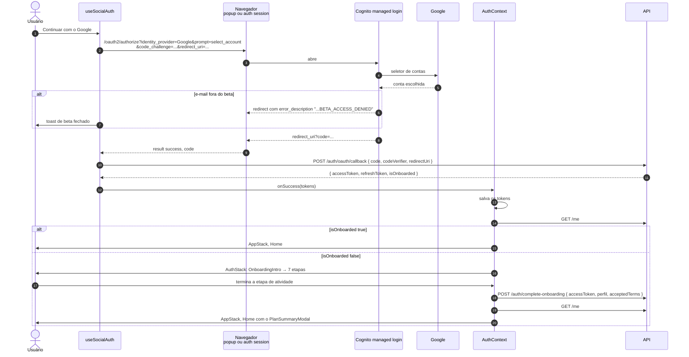

# Fluxo: login com Google

## Resumo

O app abre o login do Google pelo **managed login do Cognito** (Authorization Code + PKCE), recebe o `code` de volta e manda `code` + `code_verifier` para a API, que troca pelos tokens. Se a conta é nova (ou o onboarding ficou pela metade), o app leva o usuário ao onboarding sem a etapa de criar conta e termina com `POST /auth/complete-onboarding`.

| | |
|---|---|
| **Entradas** | "Continuar com o Google" no `SignInBottomSheet` (`Welcome`) e no `CreateAccountStep` (fim do onboarding) |
| **Hooks** | `useSocialAuth`, `useOnboardingSubmit`, `AuthContext` (`signInWithSocial`, `completeOnboarding`, `completeSocialOnboarding`) |
| **Rotas** | Cognito `/oauth2/authorize` (navegador), `POST /auth/oauth/callback`, `POST /auth/complete-onboarding`, `GET /me` |

## Diagrama de sequência

## Passo a passo

### 1. Pedido de autorização (`useSocialAuth`)

- `AuthSession.useAuthRequest` monta o pedido com o `EXPO_PUBLIC_COGNITO_CLIENT_ID`, `responseType: code`, PKCE (padrão do `expo-auth-session`) e dois parâmetros extras: `identity_provider: 'Google'` (pula a tela do Cognito e vai direto ao Google) e `prompt: 'select_account'` (o Google sempre mostra o seletor de contas).
- O `discovery` só tem o `authorizationEndpoint` (`<EXPO_PUBLIC_COGNITO_DOMAIN>/oauth2/authorize`). O app **não** troca o `code` no Cognito: quem faz isso é a API, que tem o client secret.
- `redirectUri` vem de `AuthSession.makeRedirectUri()`: a origem do app no web e um URI com o scheme `nacal` no nativo. Precisa estar entre os callbacks do app client no Cognito.
- O `prompt=select_account` só chega ao Google porque o domínio do Cognito está em **managed login (v2)**; no hosted UI clássico ele é descartado. Isso é configuração da API (`sls/resources/userPool.yaml`), não do app.

### 2. Troca do `code` pela sessão

`AuthService.signInWithSocial` manda `{ code, codeVerifier, redirectUri }` para `POST /auth/oauth/callback`. A API troca no Cognito, cria a conta se ela não existir (com `isOnboarded: false`) e devolve os tokens. O app ignora o `isOnboarded` da resposta e usa o do `GET /me`, que o `setupAuth` busca de qualquer jeito.

### 3. Conta já com onboarding

`signInWithSocial` salva os tokens, descarta um cadastro por e-mail pendente que estivesse em memória e roda o `setupAuth`. Com `isOnboarded: true`, o `RootStack` troca para a `AppStack`.

### 4. Conta sem onboarding

Depende de onde o usuário tocou no botão:

| Entrada | O que acontece |
|---|---|
| **Login** (`SignInBottomSheet`) | `shouldShowOnboarding` vira `true`; a `Welcome` navega para `OnboardingIntro` e o usuário faz as etapas 1 a 7 (sem `CreateAccountStep`). No "Continuar" da última, `finishOnboarding` chama `completeOnboarding(perfil)` |
| **Fim do onboarding** (`CreateAccountStep`) | O usuário já preencheu tudo. `handleSignUpSocialSuccess` chama primeiro `signInWithSocial` (salva os tokens e busca o `GET /me`). Se a conta Google **já tem onboarding**, para ali: o usuário só entra e os dados do formulário são ignorados. Se não tem, chama `completeSocialOnboarding(tokens, perfil)` na hora, sem passar pelo `OnboardingIntro` |

`completeOnboarding` lê o access token guardado e manda `POST /auth/complete-onboarding` com o token **no body** junto do perfil e do aceite dos termos. A API valida o token, grava o perfil e calcula a meta. Depois, o `setupAuth` busca o `/me` de novo e `isSignedUp` vira `true`.

### 5. Desistir no meio

Se o usuário sai do onboarding (volta para a `Welcome`) logado, sem onboarding e sem cadastro pendente, o `OnboardingIntro` (no `beforeRemove`) e o container `Onboarding` (ao perder o foco) chamam `signOut()`. O `OnboardingIntro` também tem o botão "Sair da conta". Ele volta deslogado, sem ficar preso numa conta sem perfil ([sessão](../03-navegacao-e-sessao.md#sair-da-conta)). A conta continua existindo na API com `isOnboarded: false` e o próximo login com Google cai no onboarding de novo.

## Erros e casos de borda

| Situação | Reação |
|---|---|
| Usuário fecha o popup ou cancela | `result.type` diferente de `success` e de `error`: nada acontece |
| E-mail fora do beta | O trigger `PreSignUp` do Cognito recusa e o redirect volta com `error_description` contendo `BETA_ACCESS_DENIED`; toast com a mensagem do beta |
| Outro erro no redirect | Toast genérico |
| `400 INVALID_GRANT` no callback | `code` inválido ou já usado: apaga os tokens e mostra "Falha na autenticação. Tente novamente." |
| `INVALID_GRANT` no `complete-onboarding` | Token recusado: apaga os tokens e repete o login com Google **uma vez** (`reauthAttemptedRef`); depois do novo login, envia o perfil de novo |
| Google no fim do onboarding numa conta que já tem onboarding | O usuário entra na conta existente; o que ele preencheu nas etapas é descartado |
| E-mail com cadastro por e-mail ainda não confirmado | A API descarta o cadastro pendente; a conta nasce sem onboarding ([cadastro](auth-cadastro-email.md#erros-e-casos-de-borda)) |
| PWA de **dev** instalado no iOS | O login não completa: o iOS recarrega o PWA ao fechar a folha e a troca do `code` se perde. Não acontece no PWA de produção. Em dev, valide o Google no navegador |
| Primeiro login dentro do PWA instalado no iOS pede a senha do Google | Limitação do iOS: o PWA tem cookies separados do Safari |

## Arquivos envolvidos

| Parte | Arquivo |
|---|---|
| OAuth + PKCE | [`useSocialAuth.ts`](../../../src/app/hooks/useSocialAuth.ts) |
| Entrada pelo login | [`SignInBottomSheet/index.tsx`](../../../src/ui/components/SignInBottomSheet/index.tsx) |
| Entrada pelo onboarding e conclusão | [`useOnboardingSubmit.ts`](../../../src/ui/screens/onboarding/useOnboardingSubmit.ts), [`CreateAccountStep.tsx`](../../../src/ui/screens/onboarding/steps/CreateAccountStep.tsx), [`onboarding/context/index.tsx`](../../../src/ui/screens/onboarding/context/index.tsx) |
| Sessão | [`AuthContext`](../../../src/app/contexts/AuthContext/index.tsx) (`signInWithSocial`, `completeOnboarding`, `completeSocialOnboarding`) |
| Chamadas | [`AuthService.signInWithSocial`](../../../src/app/services/AuthService.ts), [`AccountsService.completeOnboarding`](../../../src/app/services/AccountsService.ts) |
| Lado da API | [Login com Google](https://github.com/nivaldoandrade/nacal-api/blob/main/docs/guide/fluxos/auth-google-oauth.md) |
