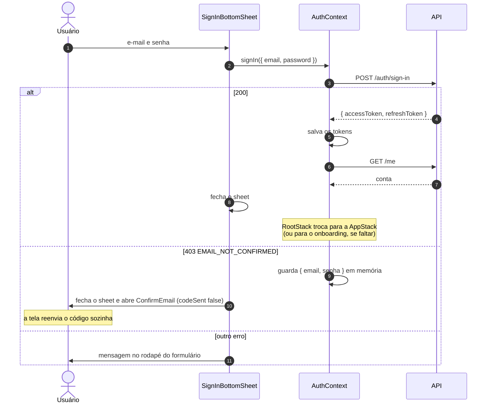
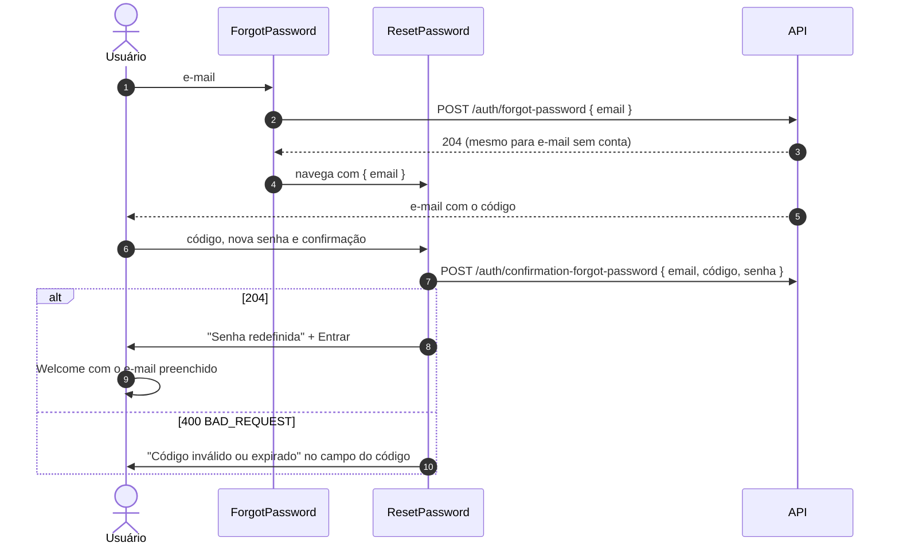

# Fluxo: login e senha

## Resumo

O login por e-mail e senha fica num bottom sheet da `Welcome`. Ele salva os tokens, busca o `GET /me` e deixa o `RootStack` trocar para a Home. A recuperação de senha é por código enviado por e-mail, em duas telas. Sair da conta só apaga a sessão no aparelho.

| Ação | Tela / componente | Rota |
|---|---|---|
| Entrar | `SignInBottomSheet` (aberto pela `Welcome`) | `POST /auth/sign-in`, `GET /me` |
| Conta não confirmada | `ConfirmEmail` | `POST /auth/resend-confirmation-code`, `POST /auth/confirm-sign-up` |
| Esqueci a senha | `ForgotPassword` → `ResetPassword` | `POST /auth/forgot-password`, `POST /auth/confirmation-forgot-password` |
| Sair | `Profile` → "Sair" | nenhuma |

Renovação do token e abertura do app estão em [Navegação e sessão](../03-navegacao-e-sessao.md).

## Login

- O schema (`SignInBottomSheet/schema.ts`) apara a senha antes de validar.
- `EMAIL_NOT_CONFIRMED`: a senha digitada fica em memória para a confirmação provar quem é o dono do cadastro. Se essa senha estiver errada, a API troca a senha na confirmação e a tela leva ao esqueci a senha ([cadastro](auth-cadastro-email.md#passo-a-passo)).
- A `Welcome` abre o sheet sozinha quando recebe `prefillEmail` (vindo do "Entrar" do fim da redefinição de senha ou da confirmação), já com o e-mail preenchido.

| Código | Mensagem |
|---|---|
| `INVALID_CREDENTIALS` | "E-mail ou senha incorretos." |
| `EMAIL_LINKED_TO_GOOGLE` | Conta criada pelo Google, sem senha: sugere "Continuar com o Google" ou "Esqueci minha senha" para criar uma |
| `TOO_MANY_ATTEMPTS` | "Muitas tentativas seguidas..." |
| `RATE_LIMIT_EXCEEDED` | "Aguarde alguns instantes e tente novamente." O `429` do throttle do API Gateway vem sem `code` e mostra a mensagem genérica, porque o login lê o `code` direto do corpo, sem `getApiErrorCode` |

## Esqueci a senha

- O link "Esqueci minha senha" fica no `SignInBottomSheet`, que fecha antes de navegar.
- `ResetPassword` tem "Reenviar código", com espera de 30 s, que chama `forgot-password` de novo.
- Nova senha e confirmação são aparadas e precisam ter 8+ caracteres e ser iguais.
- Também é o caminho para quem só entrou com Google criar uma senha, e para onde a confirmação do cadastro manda quando a senha não confere.
- Depois de redefinir, o usuário **não** é logado automaticamente: toca em "Entrar" e faz o login.

## Sair da conta

"Sair" no Perfil chama `signOut()`: apaga os tokens do aparelho, remove o header e o interceptor do axios, limpa todo o cache do TanStack Query e zera as flags do `AuthContext`. O `RootStack` volta para a `Welcome`. Não há chamada à API; o refresh token continua válido no Cognito até expirar ([detalhes](../03-navegacao-e-sessao.md#sair-da-conta)).

## Erros e casos de borda

- **Sem rede no login**: mensagem genérica no rodapé; nada é salvo.
- **Login com conta sem onboarding** (criada pelo Google e abandonada): `GET /me` volta `isOnboarded: false` e a `Welcome` leva ao `OnboardingIntro`.
- **Refresh recusado com o app aberto**: toast "Sua sessão expirou. Faça login novamente." e volta para a `Welcome`.
- **`ConfirmEmail` sem a senha em memória** (app reaberto): a tela mostra o campo de senha acima do código.

## Arquivos envolvidos

| Parte | Arquivo |
|---|---|
| Login | [`SignInBottomSheet/`](../../../src/ui/components/SignInBottomSheet/), [`useSignInBottomSheet.ts`](../../../src/ui/components/SignInBottomSheet/useSignInBottomSheet.ts), [`welcome/index.tsx`](../../../src/ui/screens/welcome/index.tsx) |
| Sessão | [`AuthContext`](../../../src/app/contexts/AuthContext/index.tsx) (`signIn`, `signOut`) |
| Esqueci a senha | [`forgotPassword/`](../../../src/ui/screens/forgotPassword/), [`useForgotPassword.ts`](../../../src/ui/screens/forgotPassword/useForgotPassword.ts), [`useResetPassword.ts`](../../../src/ui/screens/forgotPassword/resetPassword/useResetPassword.ts) |
| Chamadas | [`AuthService.ts`](../../../src/app/services/AuthService.ts) |
| Lado da API | [Login, refresh e senha](https://github.com/nivaldoandrade/nacal-api/blob/main/docs/guide/fluxos/auth-login-senha.md) |
