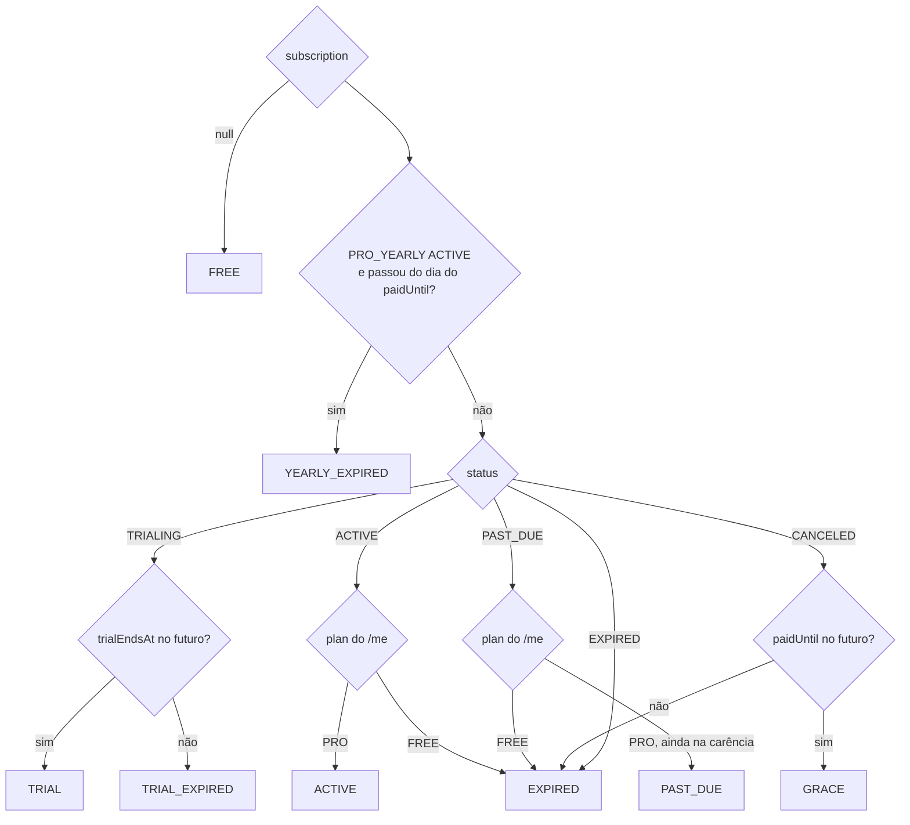
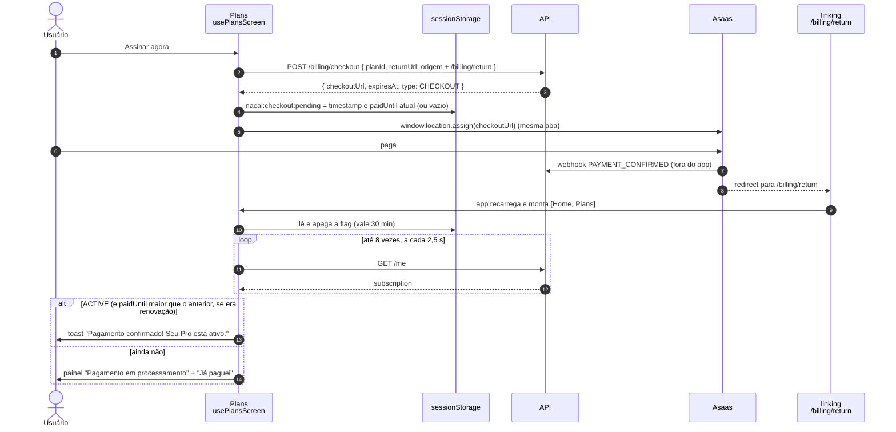
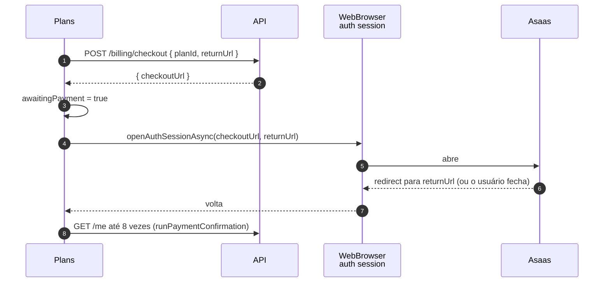

# Fluxo: planos e pagamento

## Resumo

A tela `Plans` mostra a situação do plano, oferece o trial de 7 dias, abre o checkout do **Asaas** e confirma o pagamento consultando o `GET /me`. O app **nunca** fala com o Asaas pela API dele nem recebe o webhook: ele só abre a URL que a API devolveu e espera a API dizer que a assinatura ficou `ACTIVE`. No web, o checkout abre na mesma aba; no nativo, numa sessão de navegador.

| Ação | Hook | Rota 🔒 |
|---|---|---|
| Catálogo de planos | `useGetPlans` (`['billing', 'plans']`) | `GET /billing/plans` |
| Situação do plano e cota | `useAccount` (`['accounts']`) | `GET /me` |
| Começar o trial | `useStartTrial` | `POST /billing/trial` |
| Assinar, renovar ou pagar fatura vencida | `useCreateCheckout` | `POST /billing/checkout` `{ planId, returnUrl }` |
| Cancelar | `useCancelSubscription` | `POST /billing/cancel` |

Toda a lógica da tela está em [`usePlansScreen.ts`](../../../src/ui/screens/plans/usePlansScreen.ts).

| Plano | Preço | Cota |
|---|---|---|
| Free | — | 20 refeições com IA por mês |
| Pro Mensal (`PRO_MONTHLY`) | R$ 9,99/mês, renova sozinho | Até 20 por dia |
| Pro Anual (`PRO_YEARLY`) | R$ 89,90/ano, pagamento único, sem renovação automática | Até 20 por dia |
| Trial | 7 dias grátis, sem cartão, 1 por conta | Até 20 por dia |

Preço, ciclo, dias de trial e a lista de vantagens vêm do `GET /billing/plans`; o app não tem esses valores fixos.

## Estado da tela

A tela deriva um `PlanStatus` da `subscription` do `/me` e do relógio (`derivePlanStatus` + `getYearlyExpiry`):

O `plan` do `/me` é o **plano efetivo** calculado pela API (trial ou pagamento vigente = `PRO`). Por isso `ACTIVE` com `plan: 'FREE'` é tratado como vencido: é um mensal cuja renovação ainda não foi confirmada depois da carência.

| `PlanStatus` | Trial | Seletor de ciclo | Botão principal | Cancelar |
|---|---|---|---|---|
| `FREE` (nunca assinou) | "Testar 7 dias grátis" | Sim | "Assinar agora — R$ ..." | — |
| `TRIAL` | — | Sim | "Assinar agora" | "Cancelar trial" |
| `TRIAL_EXPIRED` | — | Sim | "Assinar agora" | — |
| `ACTIVE` mensal | — | Não | — | "Cancelar assinatura" |
| `ACTIVE` anual | — | Não | — (mostra "Acesso até") | — (pagamento único) |
| `ACTIVE` anual, 30 dias ou menos | — | Não | "Renovar — R$ 89,90/ano" (só o anual) | — |
| `PAST_DUE` | — | Não | "Pagar agora" (só o ciclo atual) | — |
| `GRACE` (cancelado, com acesso) | — | Sim | "Assinar novamente" | — |
| `YEARLY_EXPIRED` | — | Sim, com o anual pré-selecionado | "Renovar" | — |
| `EXPIRED` | — | Sim | "Assinar agora" | — |

O trial só é oferecido para quem nunca teve assinatura (`subscription === null`). A API recusa outro com `TRIAL_NOT_AVAILABLE`.

Antes do botão de assinar, a tela mostra o aviso com os links para os Termos de Uso e a Política de Privacidade.

Enquanto houver `trialEndsAt` ou `paidUntil`, um relógio atualiza o `now` a cada minuto, para o status mudar sozinho (o trial terminar, por exemplo) com a tela aberta. Ao ganhar foco de navegação (abrir a tela ou voltar a ela), a tela invalida `['accounts']` e busca o `/me` de novo. Voltar para a aba do navegador não conta como foco.

## Checkout no web

1. **`returnUrl`**: `getCheckoutReturnUrl()` usa `EXPO_PUBLIC_WEB_URL` (ou `window.location.origin`) + `/billing/return`. A API só aceita a URL que começa com o `APP_WEB_URL` dela; o Asaas recusa `localhost`.
2. **Mesma aba, sem popup**: o produto é só para celular e o PWA não lida bem com popup. Antes de sair, a tela grava a flag `nacal:checkout:pending` no `sessionStorage` (que sobrevive à ida e volta na mesma aba).
3. **Volta**: o Asaas redireciona para `/billing/return`. O `linking` monta a pilha `[Home, Plans]` (assim o "voltar" da tela vai para a Home). Ao montar, `tryConsumePendingFlag` lê a flag, apaga (é de uso único) e, se tiver menos de 30 min, roda a confirmação.
4. **Fechar o Asaas sem pagar** (o "X" do Asaas no PWA faz `history.back()`): o navegador restaura a página do bfcache **sem** rodar os efeitos de novo. Por isso a tela também escuta o `pageshow` com `persisted: true` e tenta consumir a flag ali. A confirmação não acha `ACTIVE` e mostra o painel "Já paguei".
5. **Confirmação** (`runPaymentConfirmation`): até 8 consultas ao `/me`, a cada 2,5 s (cerca de 20 s). Sucesso quando a assinatura está `ACTIVE`. Se não confirmar, mostra o painel com "Já paguei" (repete a confirmação) e um toast: "Pagamento ainda em processamento..." ou o erro da última consulta.

### Renovação do anual

Na renovação, a assinatura **já está** `ACTIVE`, então "está `ACTIVE`" não prova que o pagamento novo entrou. A tela guarda o `paidUntil` de antes (na flag do `sessionStorage`, depois do `|`, e em `renewalBaselineRef`) e só considera pago quando o `paidUntil` do `/me` passa desse valor. Renovar antes do vencimento soma um ano ao `paidUntil` atual (regra da API).

### Fatura vencida (`PAST_DUE`)

Com o Pro ainda na carência, "Pagar agora" pede o checkout do ciclo atual e a API devolve a **fatura vencida** da assinatura (`type: 'INVOICE'`) em vez de um checkout novo. No web, a fatura abre em **outra aba**: a janela é aberta no clique, antes da request (senão o navegador bloqueia por não ser uma ação direta do usuário), e recebe a URL quando a resposta chega. O painel "Já paguei" aparece na hora. Se a aba foi bloqueada, cai no fluxo da mesma aba.

Com o Pro já vencido, a tela vira "Assinar agora" com seletor de ciclo e a API cancela a assinatura antiga antes de criar o checkout novo.

## Checkout no nativo

No nativo, o `returnUrl` é `EXPO_PUBLIC_WEB_URL` + `/billing/return` quando a variável existe (a API e o Asaas aceitam), ou `makeRedirectUri({ path: 'billing/return' })`. A confirmação roda sempre que a sessão do navegador fecha, tenha o usuário pago ou não.

## Trial e cancelamento

- **Trial**: `POST /billing/trial` → invalida `['accounts']` → toast "Trial de 7 dias ativado. Aproveite o Pro!". Também é oferecido no `PlanOfferModal` da Home logo depois do cadastro ([Home](home-e-dia.md#modais-do-primeiro-acesso)).
- **Cancelar**: pede confirmação ("Cancelar o trial?" / "Cancelar a assinatura?", com "Manter"). `POST /billing/cancel` → invalida `['accounts']` e `['billing', 'plans']`. O trial volta ao Free na hora; o mensal mantém o acesso até o `paidUntil` (status `GRACE` na tela). O anual não tem cancelamento: é pagamento único e simplesmente vence.

## Vencimento do Pro Anual

`getYearlyExpiry` (`src/ui/utils/`) olha `ACTIVE` + `PRO_YEARLY` + `paidUntil` e devolve:

| Estado | Quando | Onde aparece |
|---|---|---|
| `EXPIRING` | Faltam 30 dias ou menos (`isUrgent` com 7 ou menos) | Faixa na Home, linha do Perfil ("Vence em N dias") com "Renovar plano", e em Planos o aviso e "Renovar — R$ 89,90/ano" |
| `EXPIRED` | Passou do dia do `paidUntil` (a API ainda responde `PRO` nos 3 dias de carência) | Faixa na Home por até 7 dias, dispensável; Perfil "Venceu em ..."; Planos com status `YEARLY_EXPIRED` |

A comparação é por dia do calendário local, não por hora.

## Erros e casos de borda

| Situação | Reação |
|---|---|
| `409 SUBSCRIPTION_ALREADY_ACTIVE` | A API recusou criar outra assinatura: toast e recarga de `['accounts']`, para a tela mostrar a situação real |
| `TRIAL_NOT_AVAILABLE` | Toast sugerindo escolher um plano |
| `BILLING_ERROR` | Asaas fora do ar ou recusou: toast "Não conseguimos falar com o serviço de pagamento agora..." |
| `GET /billing/plans` falhou | A tela mostra o erro com opção de tentar de novo (`refetchPlans`) |
| Pagou, mas o webhook demorou mais de ~20 s | Painel "Já paguei"; ao tocar, consulta o `/me` de novo. A reconciliação horária da API cobre webhook perdido |
| Flag do checkout com mais de 30 min | Ignorada (o usuário provavelmente abandonou o pagamento) |
| `sessionStorage` indisponível | O checkout segue; a confirmação automática não roda, mas o "Já paguei" continua disponível |
| Usuário sai da tela durante a confirmação | O contador `pollRunRef` invalida a execução em andamento (também ao tocar em fechar o painel) |
| PWA instalado no iOS, fatura em outra aba | Testado em dev em 2026-11-15: ao fechar a página do Asaas, o app volta e atualiza sozinho para o Pro ativo, sem precisar do "Já paguei". O mecanismo não foi confirmado no código (não há listener de foco da janela; o `useFocusEffect` da tela é foco de navegação). A suspeita é o iOS recarregar o PWA, o que refaz o `GET /me` na abertura |

## Arquivos envolvidos

| Parte | Arquivo |
|---|---|
| Tela e lógica | [`plans/index.tsx`](../../../src/ui/screens/plans/index.tsx), [`usePlansScreen.ts`](../../../src/ui/screens/plans/usePlansScreen.ts) |
| Componentes | [`StatusCard`](../../../src/ui/screens/plans/components/StatusCard/), [`CycleTiles`](../../../src/ui/screens/plans/components/CycleTiles/), [`PlanComparison`](../../../src/ui/screens/plans/components/PlanComparison/) |
| Mutations e query | [`useStartTrial.ts`](../../../src/app/hooks/mutations/useStartTrial.ts), [`useCreateCheckout.ts`](../../../src/app/hooks/mutations/useCreateCheckout.ts), [`useCancelSubscription.ts`](../../../src/app/hooks/mutations/useCancelSubscription.ts), [`useGetPlans.ts`](../../../src/app/hooks/queries/useGetPlans.ts) |
| Chamadas | [`BillingService.ts`](../../../src/app/services/BillingService.ts) |
| `returnUrl` | [`getCheckoutReturnUrl.ts`](../../../src/app/libs/getCheckoutReturnUrl.ts) |
| Retorno no web | [`navigation/index.tsx`](../../../src/app/navigation/index.tsx) (`/billing/return`) |
| Vencimento do anual | [`getYearlyExpiry.ts`](../../../src/ui/utils/getYearlyExpiry.ts), [`YearlyExpiryNotice`](../../../src/ui/components/YearlyExpiryNotice/), [`PlanSection.tsx`](../../../src/ui/screens/profile/components/PlanSection.tsx) |
| Lado da API | [Planos, trial, checkout e webhook](https://github.com/nivaldoandrade/nacal-api/blob/main/docs/guide/fluxos/billing.md), [Reconciliação](https://github.com/nivaldoandrade/nacal-api/blob/main/docs/guide/fluxos/billing-reconciliacao.md) |
