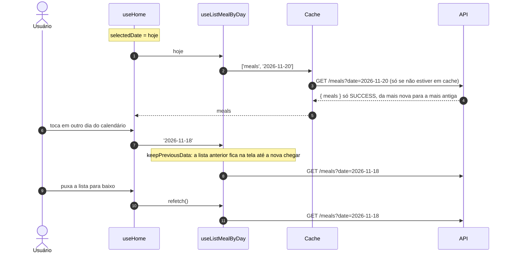
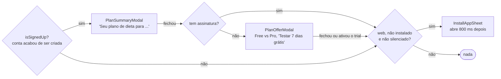

# Fluxo: Home e o dia

## Resumo

A Home mostra **um dia por vez**: o calendário da semana, o progresso de calorias e macros contra a meta (`MacroRainbow`) e as refeições daquele dia. A lista vem de `GET /meals?date=` com a data local do aparelho e fica em cache até uma ação mudar algo ou o usuário puxar para atualizar. O FAB de criação só aparece no dia de hoje.

| | |
|---|---|
| **Tela** | `Home` (primeira rota da `AppStack`) |
| **Hooks** | `useHome`, `useListMealByDay`, `useDaySummary`, `useFirstRunModals`, `useAccount` |
| **Rotas** | `GET /meals?date=AAAA-MM-DD` 🔒, `GET /me` 🔒 (já no cache desde a abertura) |
| **Contexto** | `HomeProvider` repassa refeições, dia selecionado e ações para os componentes da tela |

## Diagrama de sequência



## O que tem na tela

```text
UserHeader        avatar e nome (→ Profile) · botão de metas (→ EditGoals)
Header (lista)    YearlyExpiryNotice · WeekCalendar · CurrentGoal (dia anterior/próximo + MacroRainbow)
Lista             MealItem por refeição (→ MealDetails) · ListEmpty se não houver
CompactHeader     cabeçalho compacto que aparece ao rolar; toca para voltar ao topo
Fab               só hoje: abre as opções Áudio · Foto · Texto
```

- **`MacroRainbow`** soma os alimentos de todas as refeições do dia (`useDaySummary`: calorias arredondadas, macros com 1 casa) e compara com `account.goal`. As cores dos macros são reservadas e definidas no `DESIGN.md` (tomate = calorias, teal = proteínas, amarelo = carboidratos, laranja = gorduras).
- **`WeekCalendar`** mostra a semana do dia selecionado; dias futuros não são clicáveis.
- **`MealItem`** mostra nome, ícone, hora e totais da refeição. A hora é formatada no **`timeZone` da própria refeição** (devolvido pelo `GET /meals`), não no fuso atual do aparelho: uma refeição registrada em viagem continua com a hora de onde foi feita. Sem `timeZone` ou com um fuso inválido, usa o do aparelho.

## O dia é o dia local

`useListMealByDay` monta a chave e o parâmetro com `toLocalIsoDate(date)` (`src/app/utils/`), que usa `getFullYear/getMonth/getDate` do fuso do aparelho. **Nunca** `toISOString()`: em UTC, uma refeição registrada depois das 21 h no Brasil cairia no dia seguinte.

Do lado da API, a refeição é gravada no dia local do `timeZone` enviado na criação (fallback `America/Sao_Paulo`). App e API precisam concordar nessa regra; se um dos lados mudar, refeições "somem" do dia ou aparecem no dia errado.

## Quando a lista é buscada de novo

| Situação | Busca? |
|---|---|
| Abrir um dia pela primeira vez na sessão | Sim |
| Voltar a um dia já visto | Não, usa o cache |
| Pull-to-refresh | Sim |
| Refeição criada (foto, áudio, texto) | Não: a refeição é inserida no cache ([cache](../04-cache-e-dados-locais.md#insertmealintodaylist)) |
| Item adicionado, removido ou restaurado | Não: os itens são copiados de `['meal', id]` |
| Refeição excluída | Não: a refeição é tirada do cache |
| Refeição demorou mais de 3 min para processar | Marcada como desatualizada; busca quando a aba volta ao foco (web) ou no pull-to-refresh |
| Erro na refeição por texto | Sim, a lista de hoje (a refeição pode ter sido gravada) |

A lista só traz refeições em `SUCCESS`. Uma refeição ainda processando, rejeitada ou que falhou não aparece na Home.

## Modais do primeiro acesso

`useFirstRunModals` encadeia três avisos, sem empilhar:



- **`PlanSummaryModal`** mostra a meta calculada pelo onboarding. Aparece só quando `isSignedUp` é `true`, ou seja, logo depois de criar a conta, e não volta depois de recarregar.
- **`PlanOfferModal`** oferece o trial de 7 dias (`POST /billing/trial`) ou continuar no Free. Não aparece para quem já tem assinatura.
- **`InstallAppSheet`** ensina a instalar o PWA conforme a plataforma (Safari do iOS, outro navegador no iOS, navegador dentro de app, Android com o prompt nativo). Abre sozinho só depois dos dois modais acima, sem modal de criação aberto e fora da splash. "Agora não" silencia por 7 dias. O Perfil tem a entrada manual.

A splash de carregamento da Home (`SplashScreenLoader`) aparece no primeiro carregamento da lista, exceto logo depois de criar a conta (aí os modais de plano ocupam esse momento).

## Aviso de vencimento do anual

`YearlyExpiryNotice`, no topo da lista, aparece para assinatura `ACTIVE` do `PRO_YEARLY` com `paidUntil` (regra em `getYearlyExpiry`, `src/ui/utils/`):

| Situação | Texto | Dispensar |
|---|---|---|
| Faltam 30 dias ou menos (urgente com 7 ou menos) | "Seu Pro Anual vence em N dias." + "Renovar" | Não |
| Venceu há até 7 dias | "Seu Pro Anual venceu em DD/MM/AAAA." + "Renovar" | Sim, guardado por `paidUntil` em `@nacal:yearly-expiry-notice-dismissed` |
| Venceu há mais de 7 dias | Some da Home | — |

"Renovar" leva para `Plans`. Detalhes da renovação em [billing](billing.md#vencimento-do-pro-anual).

## Erros e casos de borda

- **Erro ao buscar a lista**: a query fica em erro (sem `retry`) e a lista aparece vazia; o pull-to-refresh tenta de novo.
- **Virar o dia com o app aberto**: `selectedDate` é criado uma vez ao montar a Home. Se o app ficar aberto de um dia para o outro, o calendário continua no dia anterior até o usuário escolher outro dia ou o app ser reaberto, e o FAB some (ele só aparece quando o dia selecionado é hoje).
- **Sair da Home com um modal de criação aberto**: o `blur` da navegação fecha o modal.

## Arquivos envolvidos

| Parte | Arquivo |
|---|---|
| Tela e estado | [`home/index.tsx`](../../../src/ui/screens/home/index.tsx), [`useHome.ts`](../../../src/ui/screens/home/useHome.ts), [`context/`](../../../src/ui/screens/home/context/) |
| Lista do dia | [`useListMealByDay.ts`](../../../src/app/hooks/queries/useListMealByDay.ts), [`toLocalIsoDate.ts`](../../../src/app/utils/toLocalIsoDate.ts) |
| Resumo do dia | [`useDaySummary.ts`](../../../src/ui/screens/home/useDaySummary.ts), [`MacroRainbow`](../../../src/ui/components/MacroRainbow/) |
| Componentes | [`home/components/`](../../../src/ui/screens/home/components/) |
| Modais do primeiro acesso | [`useFirstRunModals.ts`](../../../src/ui/screens/home/useFirstRunModals.ts), [`PlanSummaryModal`](../../../src/ui/screens/home/components/PlanSummaryModal/), [`PlanOfferModal`](../../../src/ui/screens/home/components/PlanOfferModal/), [`InstallAppSheet`](../../../src/ui/components/InstallAppSheet/) |
| Aviso do anual | [`YearlyExpiryNotice`](../../../src/ui/components/YearlyExpiryNotice/), [`getYearlyExpiry.ts`](../../../src/ui/utils/getYearlyExpiry.ts) |
| Lado da API | [Listagem do dia](https://github.com/nivaldoandrade/nacal-api/blob/main/docs/guide/fluxos/refeicao-itens.md) |
