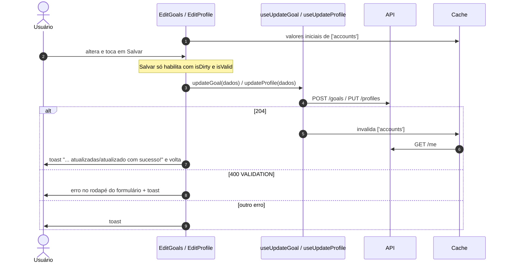

# Fluxo: perfil e metas

## Resumo

O perfil e a meta diária nascem no onboarding (a API calcula a meta). Depois, o usuário edita os dois **separadamente**: `EditProfile` muda nome, nascimento, altura, peso e gênero; `EditGoals` muda calorias e macros na mão. Mudar o peso **não** recalcula a meta. As duas telas leem os valores de `['accounts']` e invalidam essa chave ao salvar.

| Ação | Tela | Hook | Rota 🔒 |
|---|---|---|---|
| Ver perfil, meta, plano e cota | Home, `Profile` | `useAccount` | `GET /me` |
| Editar perfil | `EditProfile` | `useEditProfile` → `useUpdateProfile` | `PUT /profiles` |
| Editar meta | `EditGoals` | `useEditGoals` → `useUpdateGoal` | `POST /goals` |
| Pedir exclusão da conta | `Profile` → `DeleteAccountSheet` | — | nenhuma: abre um e-mail para o suporte |

## Diagrama de sequência

## Perfil (tela de ajustes)

`Profile` é um hub, de cima para baixo:

| Seção | Conteúdo | Para onde vai |
|---|---|---|
| `ProfileCard` | Avatar com a inicial, nome e "idade · altura · peso" | `EditProfile` |
| `PlanSection` | Nome do plano e uma linha de situação (abaixo) | `Plans` ("Ver planos", ou "Renovar plano" no anual perto de vencer ou vencido) |
| `InstallAppSection` | Entrada manual da dica de instalação, só no web e fora do modo instalado | `InstallAppSheet` |
| `LegalSection` | Termos de Uso e Política de Privacidade | `www.nacal.app` (`openExternalUrl`) |
| `AccountSection` | "Sair" e "Excluir conta" | `signOut()` / `DeleteAccountSheet` |

Linha de situação do `PlanSection`, na ordem em que as regras são testadas:

| Situação | Texto |
|---|---|
| Anual vencido | "Venceu em DD/MM/AAAA" |
| Anual com 30 dias ou menos | "Vence em N dias (DD/MM/AAAA)" |
| Free (sem assinatura ou plano efetivo Free) | "N de 20 refeições este mês" |
| Trial | "Trial — faltam N dias" / "Trial — termina hoje" |
| Anual ativo | "Acesso até: DD/MM/AAAA" |
| Mensal ativo | "Próxima cobrança: DD/MM/AAAA" |
| `PAST_DUE` | "Pagamento pendente" |
| Cancelado com acesso restante | "Acesso Pro até DD/MM/AAAA" |

## Editar perfil

- Campos: nome (até 20 caracteres), data de nascimento (`BirthDateField`: `input type=date` no web, datetimepicker no nativo), altura, peso (`MeasurementField`) e gênero (`GenderInput`).
- O formulário começa com os valores do `account.profile` em cache. Altura e peso são strings no formulário e viram número no schema.
- A data vai como `AAAA-MM-DD`. Na leitura, `AccountsService` recria o `birthDate` no fuso local a partir do dia UTC, para não aparecer um dia antes no Brasil.
- `PUT /profiles` não mexe na meta. Se o usuário quer a meta recalculada para o peso novo, hoje a única forma é editar a meta na mão.

## Editar metas

- Campos: calorias, proteínas, carboidratos e gorduras, todos obrigatórios e de pelo menos 1 (`GoalInputField`).
- O app não confere se os macros batem com as calorias; a API aceita os quatro valores como vieram.
- `POST /goals` sobrescreve a meta calculada no onboarding. A Home passa a comparar o dia com os valores novos assim que o `GET /me` volta.

## Excluir a conta

Não há rota de exclusão. "Excluir conta" abre o `DeleteAccountSheet`, que explica o processo e, no botão de confirmar, abre o app de e-mail com um `mailto:` para `contato@nacal.app` (assunto "Excluir minha conta do NaCal"). O corpo já leva o e-mail da conta (vem do `GET /me`), para o suporte saber qual conta excluir mesmo se o pedido sair de outro endereço. A exclusão é feita à mão do lado da API ([runbook de exclusão de conta](https://github.com/nivaldoandrade/nacal-api/blob/main/docs/guide/runbooks/exclusao-de-conta.md)).

Se o `mailto:` não abrir (sem app de e-mail configurado), `openExternalUrl` mostra o toast "Não foi possível abrir o link. Tente de novo."

## Erros e casos de borda

| Situação | Reação |
|---|---|
| `400 VALIDATION` | Erro no rodapé do formulário e toast "Verifique os campos e tente novamente." |
| `429 RATE_LIMIT_EXCEEDED` | Toast "Aguarde alguns instantes...". O `429` do throttle do API Gateway vem sem `code` e mostra a mensagem genérica (as duas telas leem o `code` direto do corpo, sem `getApiErrorCode`) |
| Sem rede | Toast genérico "Ocorreu um erro. Tente novamente."; o formulário continua preenchido |
| Abrir `EditGoals` ou `EditProfile` com `['accounts']` vazio | Não acontece na prática: a conta é carregada na abertura do app e a `AppStack` só aparece com ela |

## Arquivos envolvidos

| Parte | Arquivo |
|---|---|
| Hub de ajustes | [`profile/`](../../../src/ui/screens/profile/), [`PlanSection.tsx`](../../../src/ui/screens/profile/components/PlanSection.tsx), [`DeleteAccountSheet.tsx`](../../../src/ui/screens/profile/components/DeleteAccountSheet.tsx) |
| Editar perfil | [`editProfile/`](../../../src/ui/screens/editProfile/), [`useEditProfile.ts`](../../../src/ui/screens/editProfile/useEditProfile.ts), [`useUpdateProfile.ts`](../../../src/app/hooks/mutations/useUpdateProfile.ts) |
| Editar metas | [`editGoals/`](../../../src/ui/screens/editGoals/), [`useEditGoals.ts`](../../../src/ui/screens/editGoals/useEditGoals.ts), [`useUpdateGoal.ts`](../../../src/app/hooks/mutations/useUpdateGoal.ts) |
| Chamadas | [`AccountsService.ts`](../../../src/app/services/AccountsService.ts), [`GoalService.ts`](../../../src/app/services/GoalService.ts) |
| Links e e-mail de suporte | [`config/legal.ts`](../../../src/app/config/legal.ts), [`openExternalUrl.ts`](../../../src/app/libs/openExternalUrl.ts) |
| Lado da API | [Perfil e meta](https://github.com/nivaldoandrade/nacal-api/blob/main/docs/guide/fluxos/perfil-e-meta.md) |
