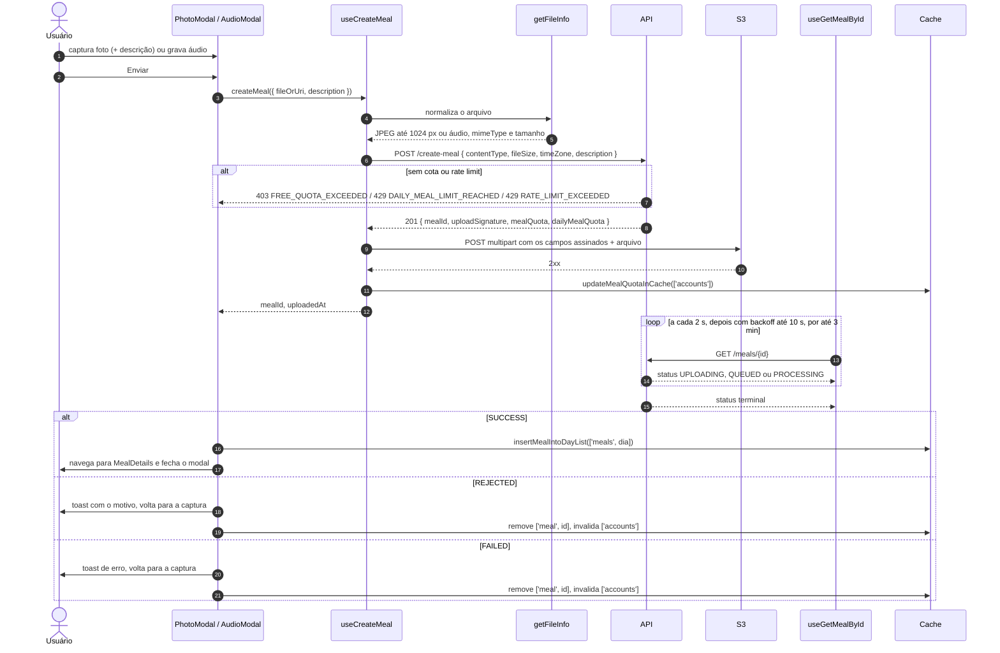
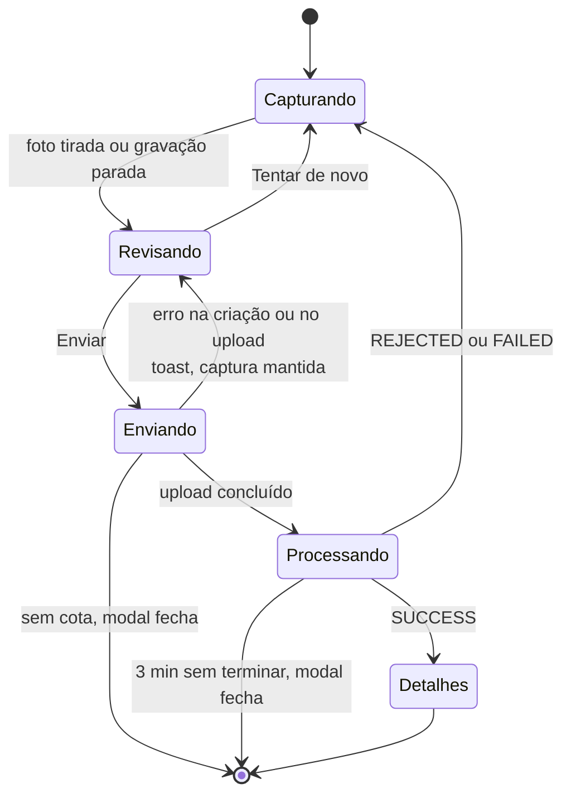

# Fluxo: refeição por foto ou áudio

## Resumo

O usuário tira uma foto do prato (com uma descrição opcional) ou grava até 30 s de áudio. O app normaliza o arquivo, pede à API um formulário assinado do S3, sobe o arquivo **direto no S3** e consulta `GET /meals/{id}` com backoff até a refeição terminar. Em `SUCCESS`, abre os detalhes; em `REJECTED` ou `FAILED`, mostra o motivo e deixa tentar de novo no mesmo modal.

| | |
|---|---|
| **Entrada** | FAB da Home → "Foto" ou "Áudio" |
| **Componentes** | `PhotoModal` / `AudioModal` (dentro de `CreateMealModals`), `CreateMealLoader`, `MealQuotaNotice` |
| **Hooks** | `usePhotoModal` / `useAudioModal` → `useCreateMeal` + `useGetMealById` |
| **Rotas** | `POST /create-meal` 🔒, upload no S3 (presigned POST), `GET /meals/{id}` 🔒 |
| **Limites** | Áudio de até 30 s · descrição da foto de até 300 caracteres · foto em JPEG de até 1024 px |

## Diagrama de sequência

## Passo a passo

### 1. Abrir o modal

O FAB da Home abre um bottom sheet com "Áudio", "Foto" e "Texto". Ao abrir, ele chama `loadAccount()` para atualizar a cota; com a cota do mês (Free) ou do dia (Pro) esgotada, as três opções ficam desativadas e o `MealQuotaNotice` explica ([cotas](../05-erros-cotas-e-mensagens.md#cotas-na-interface)). A escolha vira `activeCreateMealModal` no `useHome`, que renderiza o modal certo pelo `CreateMealModals`.

### 2. Capturar

**Foto** (`PhotoModal`):

- Ao abrir, o modal só **confere** a permissão da câmera (`useCameraPermissions`, sem pedir). Sem ela, mostra "Ativar câmera" e pede no toque em "Conceder permissão"; se o usuário já negou, o modal explica.
- No nativo, `CameraCapture.tsx` usa o `CameraView` do `expo-camera` (câmera traseira). No web, `CameraCapture.web.tsx` abre a câmera com `getUserMedia` (ideal 3840 × 2160), tem zoom por pinça e duplo toque (1× a 3×) e captura **só a área visível** do preview num canvas, em JPEG 0,95.
- Depois da foto, o modal entra em revisão: mostra a foto, o campo opcional "Quer contar algum detalhe?" (`PhotoDescriptionInput`, até 300 caracteres, para o que a foto não mostra: bebida em copo opaco, ingrediente escondido, quantidade, qual refeição foi) e os botões "Tentar de novo" e "Enviar".

**Áudio** (`AudioModal`):

- A permissão do microfone é pedida quando o modal abre; negada, aparece só o toast "Permissão para acessar o microfone foi negada" (o modal não tem tela de explicação). O modo de áudio liga `playsInSilentMode` e `allowsRecording`.
- `expo-audio` grava com o preset `HIGH_QUALITY`. Aos 30 s, a gravação para sozinha e vai para a revisão (`Actions.tsx` observa a duração a cada 100 ms).
- Na revisão, o `Player` deixa ouvir antes de enviar.

### 3. Normalizar o arquivo (`getFileInfo`)

| Plataforma | Foto | Áudio |
|---|---|---|
| Web | `data:` da captura vira `File`. Se não for JPEG, passar de 2 MB ou de 1024 px no lado maior, reencoda num canvas para JPEG 0,9 com fundo branco | `blob:` vira `File` com MIME normalizado (`audio/webm` ou `audio/m4a`) |
| Nativo | `expo-image-manipulator` reduz para até 1024 px e salva em JPEG 0,9 | arquivo `.m4a` do gravador, enviado como `audio/m4a` |

Tipos aceitos: `image/jpeg`, `audio/webm`, `audio/m4a`. Qualquer outro, ou arquivo vazio, lança erro antes de falar com a API.

### 4. Criar a refeição e subir o arquivo (`MealsService.create`)

1. `POST /create-meal` com `contentType`, `fileSize`, `timeZone` (IANA do aparelho, por `getDeviceTimeZone`: `expo-localization` com fallback para `Intl`) e `description` (aparada; vazia não é enviada). A API **consome a cota aqui**, cria a refeição em `UPLOADING` e devolve o `uploadSignature`.
2. O `uploadSignature` é um JSON em base64 com `url` e `fields`. `Service.uploadPresignedPOST` decodifica, monta um `FormData` com todos os campos e o arquivo por último, e faz `POST` no S3 com um axios **sem** o client da API (sem `Authorization`, sem interceptor).
3. O `onSuccess` da mutation grava a cota devolvida em `['accounts']` (`updateMealQuotaInCache`), sem refazer o `GET /me`.
4. A mutation devolve `mealId` e `uploadedAt` (o momento em que o upload terminou), que ligam o polling.

O fuso importa: a API usa o `timeZone` para nomear a refeição pelo horário local (café da manhã, almoço...) e para gravá-la no dia local certo. A lista da Home pede o dia pela data local do aparelho ([Home](home-e-dia.md#o-dia-é-o-dia-local)).

### 5. Acompanhar o processamento

`useGetMealById(mealId, uploadedAt)` consulta a refeição a cada 2 s nos primeiros 20 s, depois com intervalo crescente (× 1,5) até 10 s, e para em 3 min ([polling](../04-cache-e-dados-locais.md#polling-do-status-da-refeição)). Enquanto isso, o `CreateMealLoader` cobre o modal inteiro, inclusive o botão de fechar (`absoluteFill`, `zIndex: 999`, recebendo os toques); só o "voltar" do sistema (Android, Esc no web) fecha o modal nesse intervalo.

O status passa por `UPLOADING → QUEUED → PROCESSING` do lado da API (upload confirmado pelo evento do S3, fila SQS, gate de foto e IA). O app não distingue esses três: para ele, todos são "processando".

### 6. Reagir ao status final

| Status | O que o modal faz |
|---|---|
| `SUCCESS` | Insere a refeição na lista do dia no cache (`insertMealIntoDayList`), navega para `MealDetails` e fecha o modal com animação `fade` (no nativo, depois do `transitionEnd` da navegação; no web, na hora). O loader continua visível até o modal fechar |
| `REJECTED` | Toast informativo no toaster do modal com o motivo (`getMealRejectionMessage`), remove `['meal', id]`, invalida `['accounts']` (a API estorna até 5 rejeições por dia; da 6ª em diante a cota fica consumida) e volta para a captura limpando foto, descrição ou áudio |
| `FAILED` | Toast de erro ("Ocorreu um erro ao tentar processar sua refeição. Tente novamente!"), o mesmo reset do `REJECTED`. A falha é sempre estornada |
| Ainda processando aos 3 min | Toast "Sua refeição está demorando mais que o normal. Ela vai aparecer na sua lista assim que ficar pronta.", marca `['meal', id]` e `['meals', dia]` como desatualizadas **sem buscar** (`refetchType: 'none'`) e fecha o modal |

Cada reação roda uma vez por refeição (refs `rejectedMealIdRef`, `failedMealIdRef`, `timedOutMealIdRef`), mesmo que o efeito rode de novo.

## Estados da refeição vistos pelo app

## Erros e casos de borda

| Situação | Reação |
|---|---|
| `403 FREE_QUOTA_EXCEEDED` | Fecha o modal, toast de erro e navega para `Plans` |
| `429 DAILY_MEAL_LIMIT_REACHED` (Pro) | Fecha o modal, toast informativo, invalida `['accounts']` |
| `429 RATE_LIMIT_EXCEEDED` | Toast no modal ("Aguarde alguns instantes"); a captura continua para reenviar |
| Outro erro na criação ou no upload | Toast "Ocorreu um erro ao criar a sua refeição. Tente novamente!" no modal; a captura continua |
| Upload falhou depois do `201` | A refeição fica em `UPLOADING` na API; depois de 15 min a API marca `FAILED` e estorna a cota. Ela não aparece na Home (a lista só traz `SUCCESS`) |
| Câmera negada | O modal explica e oferece "Conceder permissão"; no web, câmera indisponível mostra um aviso com "Tentar novamente" |
| Microfone negado | Só o toast "Permissão para acessar o microfone foi negada" |
| Usuário fecha o modal durante o processamento (só pelo "voltar" do sistema, o X fica coberto pelo loader) | O polling para junto com o modal. A refeição continua na API e aparece na lista quando a Home for atualizada (pull-to-refresh) |
| Usuário sai da Home (vai para outra tela) com o modal aberto | O `useHome` fecha o modal no `blur` da navegação |
| Refeição demorou mais de 3 min | Ver a última linha da tabela do passo 6. No web, a lista é buscada de novo quando a aba volta ao foco; no nativo, no pull-to-refresh |

## Arquivos envolvidos

| Etapa | Arquivo |
|---|---|
| FAB e opções | [`home/components/Fab`](../../../src/ui/screens/home/components/Fab/index.tsx), [`CreateMealOptions`](../../../src/ui/components/CreateMealOptions/index.tsx), [`CreateMealModals.tsx`](../../../src/ui/components/CreateMealModals.tsx) |
| Foto | [`PhotoModal`](../../../src/ui/components/PhotoModal/), [`usePhotoModal.ts`](../../../src/ui/components/PhotoModal/usePhotoModal.ts), [`CameraCapture`](../../../src/ui/components/PhotoModal/components/CameraCapture/) |
| Áudio | [`AudioModal`](../../../src/ui/components/AudioModal/), [`useAudioModal.ts`](../../../src/ui/components/AudioModal/useAudioModal.ts), [`Actions.tsx`](../../../src/ui/components/AudioModal/Actions.tsx) |
| Normalização | [`getFileInfo.ts`](../../../src/app/libs/getFileInfo.ts), [`config/mealImage.ts`](../../../src/app/config/mealImage.ts) |
| Criação e upload | [`useCreateMeal.ts`](../../../src/app/hooks/mutations/useCreateMeal.ts), [`MealsService.create`](../../../src/app/services/MealsService.ts), [`Service.uploadPresignedPOST`](../../../src/app/services/Service.ts) |
| Polling | [`useGetMealById.ts`](../../../src/app/hooks/queries/useGetMealById.ts) |
| Cache | [`mealItemsCache.ts`](../../../src/app/hooks/mutations/mealItemsCache.ts), [`mealQuotaCache.ts`](../../../src/app/hooks/mutations/mealQuotaCache.ts) |
| Mensagens de rejeição | [`getMealRejectionMessage.ts`](../../../src/app/libs/getMealRejectionMessage.ts) |
| Lado da API | [Refeição por foto ou áudio](https://github.com/nivaldoandrade/nacal-api/blob/main/docs/guide/fluxos/refeicao-foto-audio.md) |
