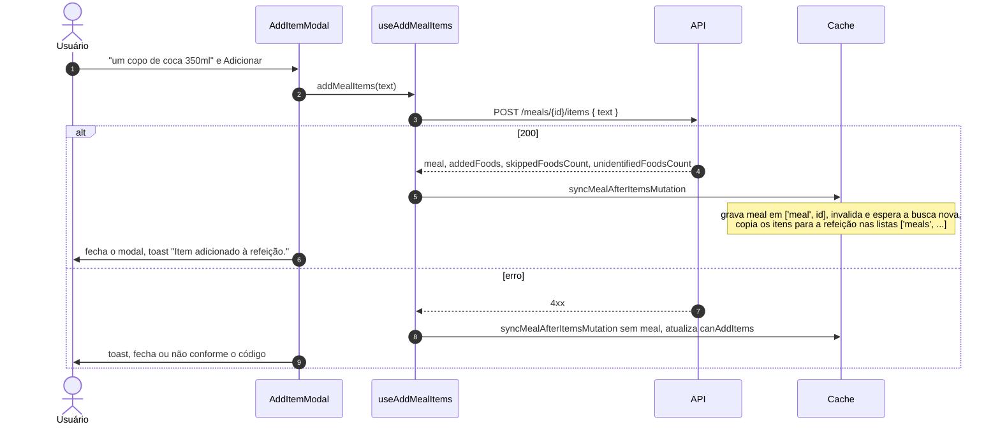
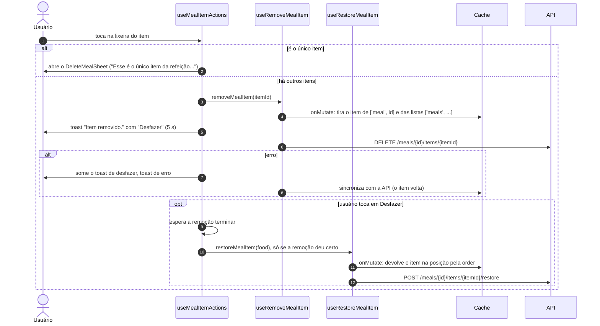

# Fluxo: detalhes da refeição e itens

## Resumo

A tela `MealDetails` mostra os totais e os itens de uma refeição e deixa **adicionar itens por texto**, **remover** (com "Desfazer"), **restaurar** e **excluir a refeição**. O que aparece é decidido pela API: os campos `canAddItems` e `canRemoveItems` do `GET /meals/{id}` ligam e desligam os botões. Remover e restaurar são otimistas; adicionar espera a resposta.

| Ação | Hook | Rota 🔒 | Atualização |
|---|---|---|---|
| Ver | `useGetMealById(mealId)` | `GET /meals/{id}` | — |
| Adicionar item | `useAddMealItems` (via `useAddItemModal`) | `POST /meals/{id}/items` `{ text }` | Depois da resposta |
| Remover item | `useRemoveMealItem` (via `useMealItemActions`) | `DELETE /meals/{id}/items/{itemId}` | Otimista |
| Desfazer remoção | `useRestoreMealItem` | `POST /meals/{id}/items/{itemId}/restore` | Otimista |
| Excluir refeição | `useDeleteMeal` | `DELETE /meals/{id}` | Depois da resposta |

## A tela

- **Cabeçalho**: calorias totais (`Header`) e a divisão de carboidratos, proteínas e gorduras em gramas e em % das calorias (`Macros`, com 4/4/9 kcal por grama; a % de gorduras é o que sobra para fechar 100).
- **Lista**: um item por alimento, com quantidade e nome; a `key` é o `id` do item. Com `canRemoveItems`, cada item tem uma lixeira.
- **Rodapé** (só aparece se houver alguma ação):
  - com `canAddItems`: o botão "Adicionar item", ou o card `UnidentifiedHint` no lugar dele quando a refeição tem `unidentified`;
  - com status `SUCCESS`: "Excluir refeição".

| Campo da API | Quando é `true` (regra da API) | Efeito |
|---|---|---|
| `canAddItems` | `SUCCESS`, nas primeiras 24 h, menos de 5 adições e abaixo de 30 itens (a cota do Free é conferida só no envio) | Mostra "Adicionar item" ou o `UnidentifiedHint` |
| `canRemoveItems` | `SUCCESS` (sem janela de tempo) | Mostra a lixeira em cada item |
| `unidentified` | A IA viu algo que não conseguiu identificar na foto: `DRINK`, `PACKAGED`, `COVERED` ou `OTHER`. Zerado pela API depois da primeira adição | Troca o botão pelo card "Tinha algo no copo?" e adapta o modal |

## Adicionar item

1. O `AddItemModal` recebe até 300 caracteres (`LimitedTextInput`). Com `hint` (categoria do `unidentified`), título, subtítulo e placeholder mudam conforme `UnidentifiedHint/copy.ts` (por exemplo, "Ex.: um copo de suco de laranja 300ml").
2. A chamada é síncrona, sem polling. Fechar o modal fica bloqueado enquanto ela roda.
3. No sucesso, o toast resume o resultado. Se a API descartou itens por falta de vaga (`skippedFoodsCount > 0`) ou porque o texto não dizia qual alimento era (`unidentifiedFoodsCount > 0`), o toast vira informativo e explica.
4. Adicionar **não consome cota**, mas é bloqueado para Free sem cota (`FREE_QUOTA_EXCEEDED`). O limite diário do Pro não bloqueia.
5. Uma categoria de `unidentified` que o app não conhece (API publicada antes do app) é ignorada por `isUnidentifiedKind`, e a tela mostra o botão normal.

## Remover e desfazer

- **Otimista**: o item some na hora, em `MealDetails` e na Home. Se a chamada falhar, o toast de desfazer é fechado, aparece o erro e a sincronização busca a refeição de novo, trazendo o item de volta.
- **Desfazer** espera a promessa da remoção: se ela falhou, não há o que desfazer. O item volta na posição original pela `order` (`insertFoodByOrder`).
- **Corridas**: remover, restaurar e adicionar da mesma refeição compartilham a `mutationKey` `['meal-items', mealId]` e só a última a terminar sincroniza o cache ([cache](../04-cache-e-dados-locais.md#mutations-de-itens)). Remover dois itens rápido, ou remover e desfazer, não faz uma resposta velha sobrescrever a mais nova.
- **Por que não buscar a lista da Home de novo**: o `GET /meals` lê um índice eventualmente consistente e poderia trazer o item removido de volta. Os itens são copiados de `['meal', id]`, que é lido com consistência forte.
- A API não deixa uma refeição vazia: no único item, a lixeira abre a confirmação de excluir a refeição inteira.

## Excluir a refeição

1. "Excluir refeição" (ou a lixeira do único item) abre o `DeleteMealSheet`, bottom sheet com "Manter" e "Sim, excluir". O texto muda entre o caso normal e o do único item.
2. `useDeleteMeal` chama `DELETE /meals/{id}`. `404 RESOURCE_NOT_FOUND` conta como sucesso (a refeição já não existe).
3. No sucesso: tira a refeição de todas as listas `['meals', ...]`, fecha os toasts de "Desfazer" ainda abertos, fecha o sheet, volta para a tela anterior (ou vai para a Home, sem pilha) e mostra "Refeição excluída.".
4. Quando a tela desmonta, remove `['meal', id]` do cache.

Não há "Desfazer" na exclusão, e a cota do mês **não** é estornada.

## Erros e casos de borda

| Situação | Adicionar | Remover / desfazer | Excluir |
|---|---|---|---|
| `NO_FOOD_IDENTIFIED` | Toast no modal, que continua aberto com o texto | — | — |
| `RATE_LIMIT_EXCEEDED` | Toast no modal, continua aberto | Toast informativo | Toast informativo |
| `MEAL_NOT_EDITABLE` | Fecha o modal com toast (passou das 24 h, por exemplo) | "Essa refeição não pode mais ser editada." | "Essa refeição não pode ser excluída agora." |
| `MEAL_ITEM_LIMIT_REACHED` | Fecha o modal com toast | Desfazer: toast informativo | — |
| `MEAL_LAST_ITEM` | — | Toast informativo (o app normalmente evita abrindo o sheet antes) | — |
| `FREE_QUOTA_EXCEEDED` | Fecha o modal com toast | — | — |
| `RESOURCE_NOT_FOUND` | Fecha o modal com toast | Erro genérico | Conta como sucesso |
| Outro erro | Toast no modal, continua aberto | "Não conseguimos remover o item." / "...desfazer a remoção." | "Não conseguimos excluir a refeição." |

Depois de qualquer erro ao adicionar, `['meal', id]` é buscada de novo para atualizar `canAddItems` (o botão pode sumir).

## Arquivos envolvidos

| Parte | Arquivo |
|---|---|
| Tela | [`screens/mealDetails/index.tsx`](../../../src/ui/screens/mealDetails/index.tsx) |
| Remover, desfazer e excluir | [`useMealItemActions.ts`](../../../src/ui/screens/mealDetails/useMealItemActions.ts), [`DeleteMealSheet`](../../../src/ui/screens/mealDetails/components/DeleteMealSheet/) |
| Adicionar | [`AddItemModal`](../../../src/ui/screens/mealDetails/components/AddItemModal/), [`useAddItemModal.ts`](../../../src/ui/screens/mealDetails/components/AddItemModal/useAddItemModal.ts) |
| Aviso do não identificado | [`UnidentifiedHint`](../../../src/ui/screens/mealDetails/components/UnidentifiedHint/), [`copy.ts`](../../../src/ui/screens/mealDetails/components/UnidentifiedHint/copy.ts) |
| Mutations | [`useAddMealItems.ts`](../../../src/app/hooks/mutations/useAddMealItems.ts), [`useRemoveMealItem.ts`](../../../src/app/hooks/mutations/useRemoveMealItem.ts), [`useRestoreMealItem.ts`](../../../src/app/hooks/mutations/useRestoreMealItem.ts), [`useDeleteMeal.ts`](../../../src/app/hooks/mutations/useDeleteMeal.ts) |
| Cache | [`mealItemsCache.ts`](../../../src/app/hooks/mutations/mealItemsCache.ts) |
| Lado da API | [Consultar, editar e excluir](https://github.com/nivaldoandrade/nacal-api/blob/main/docs/guide/fluxos/refeicao-itens.md) |
