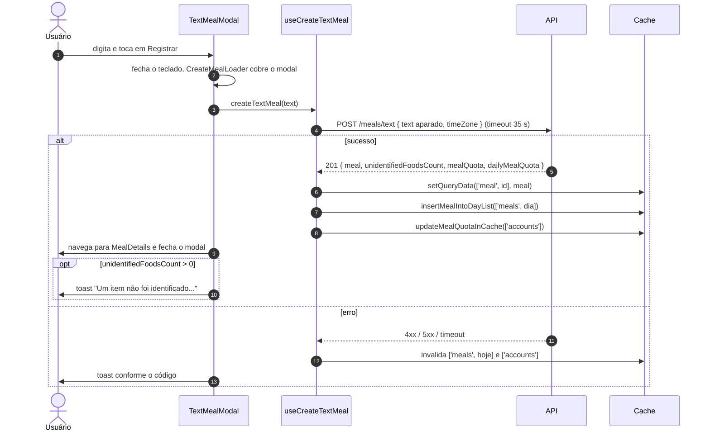

# Fluxo: refeição por texto

## Resumo

O usuário descreve a refeição numa frase ("no almoço comi arroz, feijão, um bife e salada") e a API devolve a refeição pronta **na mesma request**: sem upload, sem fila e sem polling. O app grava a refeição no cache, insere na lista do dia e abre os detalhes.

| | |
|---|---|
| **Entrada** | FAB da Home → "Texto" |
| **Componentes** | `TextMealModal` (mesmo layout do `AddItemModal`), `LimitedTextInput`, `CreateMealLoader`, `MealQuotaNotice` |
| **Hooks** | `useTextMealModal` → `useCreateTextMeal` |
| **Rota** | `POST /meals/text` 🔒 com `{ text, timeZone }` |
| **Limites** | 1 a 500 caracteres · timeout de 35 s no axios |

## Diagrama de sequência

## Passo a passo

1. **Digitar.** O `LimitedTextInput` limita a 500 caracteres e, perto do limite, troca a dica pela contagem (`N/500`). "Registrar" só habilita com texto que não seja só espaço.
2. **Enviar.** `useCreateTextMeal` chama `MealsService.createFromText`, que manda o texto aparado e o fuso do aparelho (`getDeviceTimeZone`, o mesmo da foto e do áudio). Enquanto a chamada roda, o `CreateMealLoader` cobre o modal e **fechar fica bloqueado** (`handleClose` ignora o toque com `isPending` ou `isSuccess`).
3. **Timeout de 35 s.** A API tem até 29 s para responder e o API Gateway corta em 30 s. O timeout do axios é um pouco maior para o modal nunca ficar preso no loader, mas também não abortar antes de a API ter a chance de responder.
4. **Sucesso.** A resposta já traz a refeição completa (`SUCCESS`, com alimentos e `canAddItems`). O `onSuccess` grava em `['meal', id]`, insere na lista do dia sem buscar de novo (o índice da listagem é eventualmente consistente, ver [cache](../04-cache-e-dados-locais.md#escrever-no-cache-ou-invalidar)) e atualiza a cota em `['accounts']` com o que veio no `201`.
5. **Abrir os detalhes.** Navega para `MealDetails` e fecha o modal (no nativo, depois do `transitionEnd`; no web, na hora). Como `['meal', id]` já está no cache, a tela abre sem carregamento.
6. **Itens descartados.** Se a API descartou menções que não diziam o que era ("alguma coisa no pote"), `unidentifiedFoodsCount > 0` gera um toast; se a refeição ainda aceita itens, ele sugere completar em "Adicionar item".

O horário da refeição é o do envio. "No almoço comi..." muda só o nome e o ícone que a API escolhe, não a hora.

## Erros e casos de borda

| Situação | Reação | Texto digitado |
|---|---|---|
| `422 NO_FOOD_IDENTIFIED` | Toast no modal: "Não encontrei nenhum alimento nesse texto..." | Mantido para editar |
| `429 RATE_LIMIT_EXCEEDED` | Toast no modal | Mantido |
| `403 FREE_QUOTA_EXCEEDED` | Fecha o modal, toast de erro e navega para `Plans` | Perdido |
| `429 DAILY_MEAL_LIMIT_REACHED` | Fecha o modal com toast informativo, sem ir para `Plans` | Perdido |
| Outro erro, timeout ou sem rede | Toast "Não conseguimos registrar sua refeição. Tente novamente!" no modal | Mantido |

Em **qualquer** erro, o `onError` invalida `['meals', hoje]` e `['accounts']`. O motivo: a API pode ter gravado a refeição e a resposta se perdido (rede caiu, app foi para segundo plano). Buscar de novo a lista do dia e a cota faz a refeição aparecer na Home, e o usuário não reenvia o mesmo texto sem saber que ela já foi registrada.

Texto sem nenhum alimento **não consome cota** (a API só consome depois que a IA encontra algo).

## Comparação com foto e áudio

| | Foto / áudio | Texto |
|---|---|---|
| Chamadas | `POST /create-meal` + upload no S3 + polling | Uma: `POST /meals/text` |
| Loader | Até o status terminal (até 3 min) | Até a resposta (até 35 s) |
| Fechar durante o envio | O X fica coberto pelo loader; o "voltar" do sistema fecha e o processamento continua na API | Bloqueado (`handleClose` ignora) |
| Sem alimento | `REJECTED`, cota estornada até 5 rejeições por dia | `422`, cota não consumida |
| Cache | Insere na lista quando o polling vê `SUCCESS` | Insere na lista e grava `['meal', id]` na resposta |

## Arquivos envolvidos

| Etapa | Arquivo |
|---|---|
| Modal | [`TextMealModal`](../../../src/ui/components/TextMealModal/), [`useTextMealModal.ts`](../../../src/ui/components/TextMealModal/useTextMealModal.ts) |
| Campo com limite | [`LimitedTextInput`](../../../src/ui/components/LimitedTextInput/) |
| Mutation | [`useCreateTextMeal.ts`](../../../src/app/hooks/mutations/useCreateTextMeal.ts) |
| Service | [`MealsService.createFromText`](../../../src/app/services/MealsService.ts) |
| Cache | [`mealItemsCache.ts`](../../../src/app/hooks/mutations/mealItemsCache.ts), [`mealQuotaCache.ts`](../../../src/app/hooks/mutations/mealQuotaCache.ts) |
| Lado da API | [Refeição por texto](https://github.com/nivaldoandrade/nacal-api/blob/main/docs/guide/fluxos/refeicao-texto.md) |
